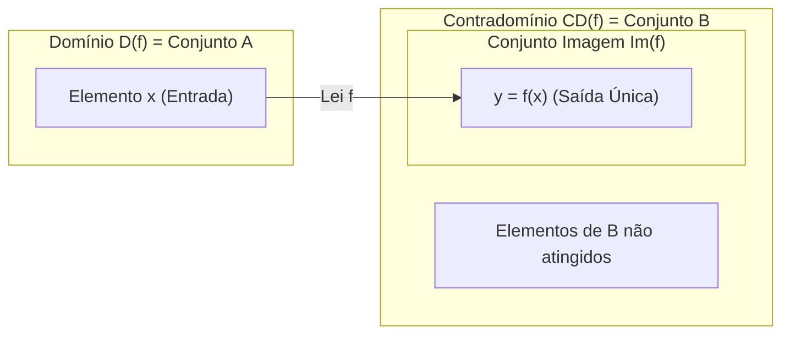
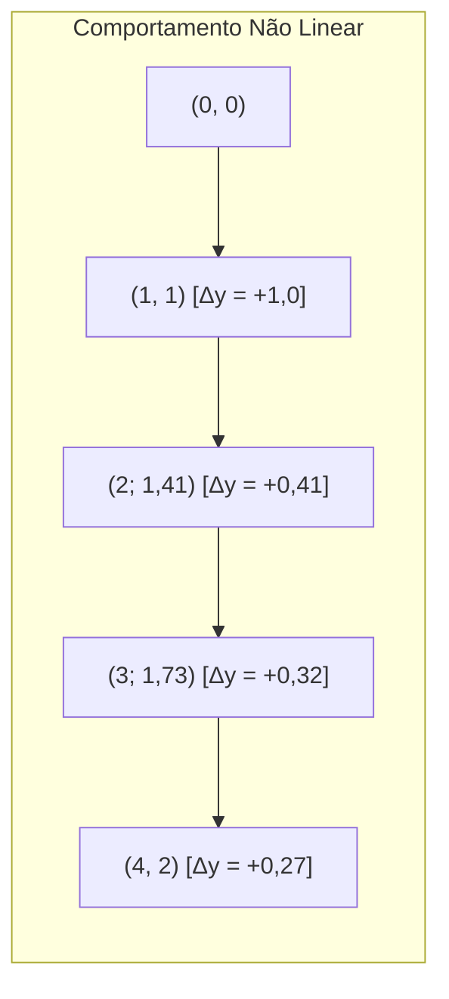

# 🎥 Videoaulas da Semana 6 — Funções: Conceitos e Representações

> **Disciplina:** Matemática Básica (`MMB002-EC-2026S2B2-T001`)  
> **Tema da Semana 6:** Funções de 1º e 2º Grau: Conceitos, Características e Representações Gráficas  
> **Docente da Aula 17:** Prof. Francisco (a convite da Profª Cláudia de Oliveira) / Coord. Profª Dra. Rúbia Barcelos Amaral  
> **Período:** 02/11/2026 a 15/11/2026  
> **Status:** 🟢 **Síntese da Videoaula 17 Concluída com Base nos Slides e Transcrição Oficial**  

---

## 🧭 Índice das Videoaulas da Semana 6

| Videoaula | Título | Foco Temático Principal | Link | Material de Apoio |
| :---: | :--- | :--- | :---: | :---: |
| **Videoaula 17** | Introdução às funções | Conceito de interdependência, variáveis dependente/independente, as 5 representações (lei, diagrama, tabela, pares ordenados e gráfico), domínio, contradomínio e imagem | [Assistir no YouTube](https://www.youtube.com/watch?v=Pd0BFajFc3A) | [`s6_slides_videoaula17-introducao_as_funcoes.pdf`](file:///home/henrique/Modelos/Univesp/2026S2B2/MMB002-Matematica-Basica/Semana-6/s6_slides_videoaula17-introducao_as_funcoes.pdf) |
| **Videoaula 18** | Função polinomial do 1º grau | Estudo formal da função afim ($f(x) = ax + b$), coeficientes angular e linear, raiz e comportamento gráfico | [Assistir no YouTube](https://www.youtube.com/watch?v=...) | [`s6_slides_videoaula18-funcao_polinomial_do_1_grau.pdf`](file:///home/henrique/Modelos/Univesp/2026S2B2/MMB002-Matematica-Basica/Semana-6/s6_slides_videoaula18-funcao_polinomial_do_1_grau.pdf) |

---

## 🎬 Videoaula 17 — Introdução às Funções

* **Docente:** Prof. Francisco  
* **Link Oficial:** [YouTube UNIVESP](https://www.youtube.com/watch?v=Pd0BFajFc3A)  
* **Slide de Apoio Oficial:** [`s6_slides_videoaula17-introducao_as_funcoes.pdf`](file:///home/henrique/Modelos/Univesp/2026S2B2/MMB002-Matematica-Basica/Semana-6/s6_slides_videoaula17-introducao_as_funcoes.pdf)  
* **Duração:** 18 min 33 s  
* **Sinopse Oficial:** *Nesta videoaula, o professor Francisco introduz os fundamentos essenciais que estruturam o conceito de função, partindo da interdependência entre grandezas cotidianas e construindo a formalização de domínio, contradomínio, conjunto imagem e suas múltiplas linguagens de representação.*

```mermaid
flowchart TD
    subgraph IdeiaCentral["1. A Essência do Conceito de Função"]
        G1["<b>Grandeza X:</b> Variável Independente (Entrada / Conjunto de Saída)"]
        REG["<b>Regra / Lei Algébrica f:</b> Processamento Unívoco"]
        G2["<b>Grandeza Y:</b> Variável Dependente (Saída / Conjunto de Chegada)"]
        G1 -->|x| REG -->|y = f(x)| G2
    end

    subgraph Representacoes["2. As 5 Linguagens de Representação"]
        R1["<b>1. Lei Algébrica:</b> y = f(x)"]
        R2["<b>2. Diagramas de Venn:</b> Flechas ligando elementos"]
        R3["<b>3. Tabela Numérica:</b> Correspondência direta de valores"]
        R4["<b>4. Pares Ordenados:</b> {(x₁, y₁), (x₂, y₂), ...}"]
        R5["<b>5. Gráfico Cartesiano:</b> Conjunto de pontos no ℝ²"]
        R1 --- R2 --- R3 --- R4 --- R5
    end

    IdeiaCentral --> Representacoes
```

---

### 🔹 1. O Que É uma Função?

A matemática utiliza as funções para modelar fenômenos onde **duas variáveis ou grandezas mantêm uma relação de interdependência**:
* Uma grandeza varia livremente no seu domínio: é a **variável independente ($x$)**.
* A outra grandeza varia em decorrência da primeira: é a **variável dependente ($y$)**.

> **Definição Formal Canônica:**  
> Sejam $A$ e $B$ dois conjuntos não vazios de números reais ($A, B \subseteq \mathbb{R}$). Uma **função** $f$ de $A$ em $B$ (notação: $f: A \to B$) é uma regra ou lei que associa a **cada elemento** $x \in A$ um **único elemento** $y \in B$.
> * O conjunto de saída $A$ denomina-se **Domínio da função**, denotado por $D(f)$ ou $\text{Dom}(f)$.
> * O conjunto de chegada $B$ denomina-se **Contradomínio da função**, denotado por $CD(f)$.
> * O subconjunto de $B$ formado por todos os elementos $y$ que efetivamente correspondem a algum $x \in A$ denomina-se **Conjunto Imagem da função**, denotado por $\text{Im}(f)$.
> 
> $$\text{Im}(f) = \{y \in B \mid \exists x \in A \text{ tal que } y = f(x)\} \subseteq CD(f)$$



---

### 🔹 2. Situação 1: Compra de Pizzas (Domínio Discreto)

O professor ilustra a teoria a partir de um exemplo contextualizado: uma pizzaria faz uma promoção de pizzas grandes a **R$ 15,00 cada**, limitando a compra a no máximo 6 pizzas.

* **Grandeza 1 ($x$):** Quantidade de pizzas compradas $\implies$ **Variável Independente**
* **Grandeza 2 ($y$):** Preço a pagar em reais $\implies$ **Variável Dependente**

#### As Cinco Formas de Representação para a Situação 1:

1. **Lei Algébrica:**
   $$y = 15x \quad \text{ou} \quad f(x) = 15x$$

2. **Diagrama de Venn:**
   Conjunto de saída $A = \{1, 2, 3, 4, 5, 6\}$ com flechas unívocas apontando para os valores em $B$.

3. **Tabela de Correspondência:**

   | Quantidade de Pizzas ($x$) | Preço a Pagar em Reais ($y = 15x$) | Par Ordenado $(x, y)$ |
   | :---: | :---: | :---: |
   | $1$ | $1 \times 15 = 15$ | $(1, 15)$ |
   | $2$ | $2 \times 15 = 30$ | $(2, 30)$ |
   | $3$ | $3 \times 15 = 45$ | $(3, 45)$ |
   | $4$ | $4 \times 15 = 60$ | $(4, 60)$ |
   | $5$ | $5 \times 15 = 75$ | $(5, 75)$ |
   | $6$ | $6 \times 15 = 90$ | $(6, 90)$ |

4. **Conjunto de Pares Ordenados:**
   $$f = \{(1, 15), (2, 30), (3, 45), (4, 60), (5, 75), (6, 90)\}$$

5. **Gráfico no Plano Cartesiano:**
   * O gráfico desta função é composto por **6 pontos isolados** no plano $\mathbb{R}^2$.
   * **Por que não é uma linha contínua?** Porque a variável $x$ é discreta (não compramos $2{,}5$ ou $3{,}7$ pizzas).
   * **Domínio:** $D(f) = \{1, 2, 3, 4, 5, 6\}$
   * **Conjunto Imagem:** $\text{Im}(f) = \{15, 30, 45, 60, 75, 90\}$
   * *(Nota: R$ 10,00 ou R$ 20,00 pertencem ao contradomínio dos reais $\mathbb{R}$, mas NÃO pertencem à imagem $\text{Im}(f)$).*

---

### 🔹 3. Situação 2: Abastecimento em Posto de Combustível (Domínio Contínuo)

Na segunda situação, examina-se a relação entre o volume em litros de gasolina abastecido e o valor total a pagar, considerando o litro a **R$ 4,50**:

* **Variável Independente ($x$):** Volume de combustível abastecido em litros.
* **Variável Dependente ($y$):** Preço total a pagar em reais.
* **Lei Algébrica:**
  $$y = 4{,}50x \quad \text{ou} \quad f(x) = 4{,}50x$$

#### Tabela de Abastecimento:

| Quantidade em Litros ($x$) | Preço a Pagar ($y = 4{,}50x$) |
| :---: | :---: |
| $10\text{ L}$ | $10 \times 4{,}50 = \text{R\$ } 45{,}00$ |
| $20\text{ L}$ | $20 \times 4{,}50 = \text{R\$ } 90{,}00$ |
| $25\text{ L}$ | $25 \times 4{,}50 = \text{R\$ } 112{,}50$ |
| $30\text{ L}$ | $30 \times 4{,}50 = \text{R\$ } 135{,}00$ |

#### Delimitação de Domínio e Imagem por Restrição Física:
Considerando que o tanque do veículo possui uma **capacidade máxima de 54 litros**:
* O volume abastecido varia continuamente de $0$ até $54$ litros:
  $$D(f) = \{x \in \mathbb{R} \mid 0 \leq x \leq 54\} = [0, 54]$$
* O valor a ser pago varia de $0$ até $54 \times 4{,}50 = \text{R\$ } 243{,}00$:
  $$\text{Im}(f) = \{y \in \mathbb{R} \mid 0 \leq y \leq 243\} = [0, 243]$$

#### Comparação Estrutural entre os Gráficos (Pizza vs. Gasolina):
* **Pizzas (Discreto):** Pontos isolados no $\mathbb{R}^2$ ($x \in \mathbb{N}$).
* **Gasolina (Contínuo):** Um **segmento de reta contínuo**, pois podemos abastecer qualquer quantidade fracionária ou decimal de litros (ex.: $27{,}8\text{ L}$).

> 💡 **Problema Prático do Tanque Parcialmente Cheio:**  
> Se o carro com capacidade de 54 L já chega ao posto com **24 L no interior do tanque**, quantos litros podem ser abastecidos até completá-lo?  
> $$\Delta x = 54 - 24 = 30\text{ litros}$$  
> Custo para encher o tanque:  
> $$y = 4{,}50 \times 30 = \text{R\$ } 135{,}00$$

---

### 🔹 4. Situação 3: Não Linearidade e Curvatura — $f(x) = \sqrt{x}$

O professor levanta a questão fundamental: **Todo gráfico de função é uma reta?**
* **Resposta:** **Não!** A reta é exclusiva das funções afins (1º grau). Existem infinitas famílias de funções cujos gráficos são curvas (parábolas, hipérboles, exponenciais, curvas trigonométricas, etc.).

Como contraexemplo introdutório, analisa-se a função raiz quadrada:
$$f(x) = \sqrt{x} \quad \text{para } x \geq 0$$

#### Tabela de Valores e Pares Ordenados:

| $x$ | $y = \sqrt{x}$ | Valor Aproximado | Par Ordenado $(x, y)$ |
| :---: | :---: | :---: | :---: |
| $0$ | $\sqrt{0}$ | $0$ | $(0, 0)$ |
| $1$ | $\sqrt{1}$ | $1$ | $(1, 1)$ |
| $2$ | $\sqrt{2}$ | $\approx 1{,}414$ | $(2; 1{,}41)$ |
| $3$ | $\sqrt{3}$ | $\approx 1{,}732$ | $(3; 1{,}73)$ |
| $4$ | $\sqrt{4}$ | $2$ | $(4, 2)$ |



* **Análise da Taxa de Variação:** Enquanto nas funções de 1º grau a taxa de variação $\frac{\Delta y}{\Delta x}$ é constante (reta), aqui os acréscimos em $y$ tornam-se progressivamente menores para variações iguais em $x$.
* **Forma Gráfica:** Gera uma **curvatura côncava** voltada para baixo.
* **Restrição de Domínio nos Reais:** Não é possível extrair raiz quadrada de número negativo no conjunto dos números reais ($\sqrt{-x} \notin \mathbb{R}$). Portanto:
  $$D(f) = \{x \in \mathbb{R} \mid x \geq 0\} = [0, +\infty[$$
  $$\text{Im}(f) = \{y \in \mathbb{R} \mid y \geq 0\} = [0, +\infty[$$

---

### 🔹 5. Síntese Teórica dos Componentes de uma Função

| Componente | Nomenclatura Formal | Papel no Mapeamento | Exemplo das Pizzas ($y = 15x$) | Exemplo da Gasolina ($y = 4,5x$) |
| :--- | :--- | :--- | :--- | :--- |
| **Conjunto de Saída** | **Domínio $D(f)$** | Todos os valores possíveis para a variável independente $x$. | $\{1, 2, 3, 4, 5, 6\}$ | $[0, 54] \subset \mathbb{R}$ |
| **Conjunto de Chegada** | **Contradomínio $CD(f)$** | O universo de valores no qual as respostas são admitidas. | Conjunto dos Números Reais $\mathbb{R}$ | Conjunto dos Números Reais $\mathbb{R}$ |
| **Conjunto das Respostas** | **Imagem $\text{Im}(f)$** | Os valores de $y$ efetivamente obtidos pela aplicação da lei $f(x)$. | $\{15, 30, 45, 60, 75, 90\}$ | $[0, 243] \subset \mathbb{R}$ |
| **Regra de Correspondência** | **Lei Algébrica $f(x)$** | A fórmula matemática unívoca que transforma cada $x$ em $y$. | $f(x) = 15x$ | $f(x) = 4{,}5x$ |

> ⚠️ **A Condição de Unicidade:**  
> Cada elemento $x$ do domínio deve estar associado a **um único** elemento $y$ da imagem. No exemplo da pizzaria, se você pede 4 pizzas, a conta é **R$ 60,00**. Não existe a possibilidade de o caixa cobrar "60 ou 70 reais". Essa unívoca determinação é a regra de ouro que define formalmente uma função.
