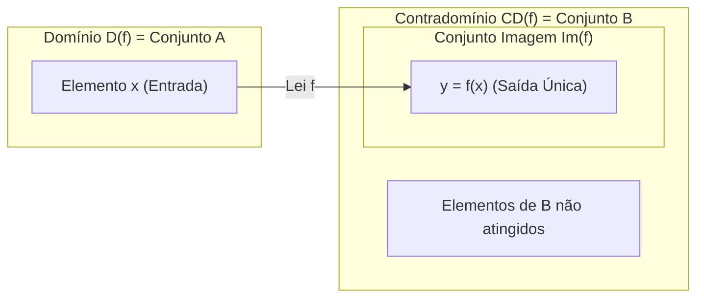
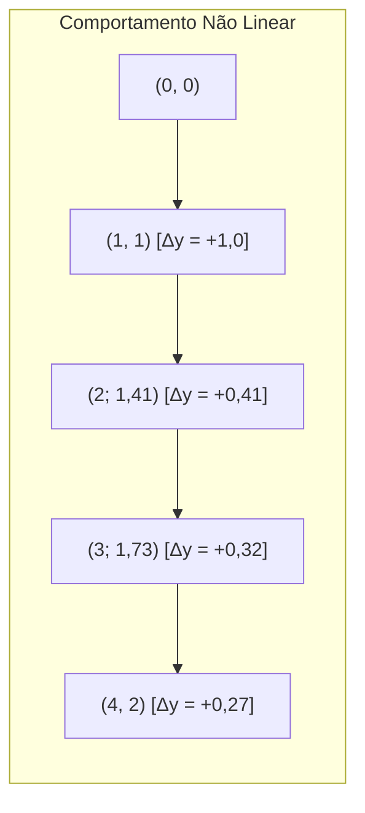
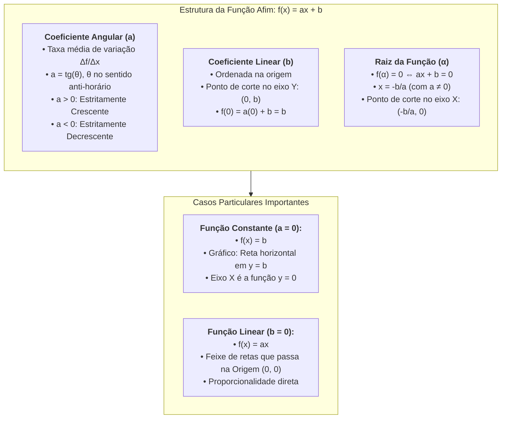
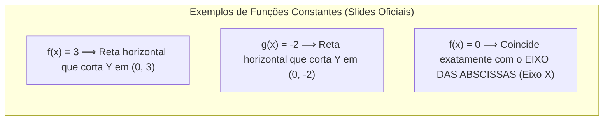
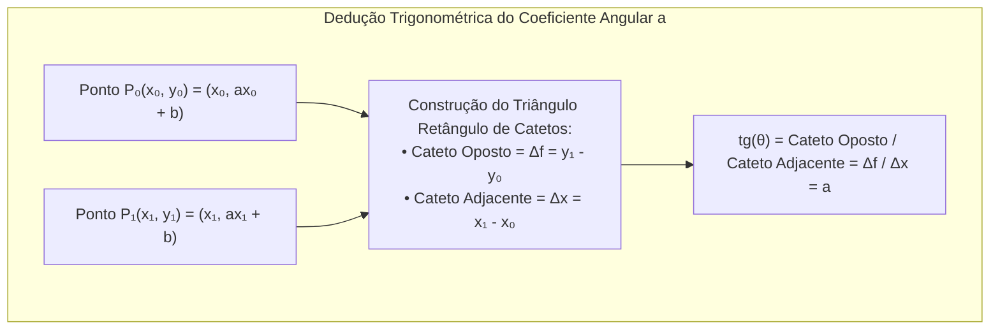
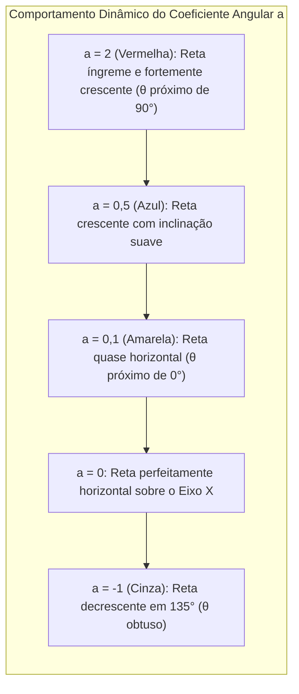

# 🎥 Videoaulas da Semana 6 — Funções: Conceitos e Representações

> **Disciplina:** Matemática Básica (`MMB002-EC-2026S2B2-T001`)  
> **Tema da Semana 6:** Funções de 1º e 2º Grau: Conceitos, Características e Representações Gráficas  
> **Docentes:** Prof. Francisco (Videoaula 17) & Prof. Cláudio Possani (Videoaula 18) / Coord. Profª Dra. Rúbia Barcelos Amaral  
> **Período:** 02/11/2026 a 15/11/2026  
> **Status:** 🟢 **Síntese das Videoaulas 17 e 18 Concluída com Base nos Slides e Transcrições Oficiais**  

---

## 🧭 Índice das Videoaulas da Semana 6

| Videoaula | Título | Foco Temático Principal | Link | Material de Apoio |
| :---: | :--- | :--- | :--- | :---: |
| **Videoaula 17** | Introdução às funções | Conceito de interdependência, variáveis dependente/independente, as 5 representações (lei, diagrama, tabela, pares ordenados e gráfico), domínio, contradomínio e imagem | [Assistir no YouTube](https://www.youtube.com/watch?v=Pd0BFajFc3A) | [`s6_slides_videoaula17-introducao_as_funcoes.pdf`](file:///home/henrique/Modelos/Univesp/2026S2B2/MMB002-Matematica-Basica/Semana-6/s6_slides_videoaula17-introducao_as_funcoes.pdf) |
| **Videoaula 18** | Função polinomial do 1º grau | Estudo formal da função afim ($f(x) = ax + b$), função constante ($a=0$), função linear ($b=0$), coeficientes angular e linear, raiz e monotonia | [Assistir no YouTube](https://www.youtube.com/watch?v=Vkxrhm_UcJU) | [`s6_slides_videoaula18-funcao_polinomial_do_1_grau.pdf`](file:///home/henrique/Modelos/Univesp/2026S2B2/MMB002-Matematica-Basica/Semana-6/s6_slides_videoaula18-funcao_polinomial_do_1_grau.pdf) |

---

## 🎬 Videoaula 17 — Introdução às Funções

* **Docente:** Prof. Francisco  
* **Link Oficial:** [YouTube UNIVESP](https://www.youtube.com/watch?v=Pd0BFajFc3A)  
* **Slide de Apoio Oficial:** [`s6_slides_videoaula17-introducao_as_funcoes.pdf`](file:///home/henrique/Modelos/Univesp/2026S2B2/MMB002-Matematica-Basica/Semana-6/s6_slides_videoaula17-introducao_as_funcoes.pdf)  
* **Duração:** 18 min 33 s  
* **Sinopse Oficial:** *Nesta videoaula, o professor Francisco introduz os fundamentos essenciais que estruturam o conceito de função, partindo da interdependência entre grandezas cotidianas e construindo a formalização de domínio, contradomínio, conjunto imagem e suas múltiplas linguagens de representação.*

```mermaid
flowchart TD
    subgraph IdeiaCentral["1. A Essência do Conceito de Função"]
        G1["<b>Grandeza X:</b> Variável Independente (Entrada / Conjunto de Saída)"]
        REG["<b>Regra / Lei Algébrica f:</b> Processamento Unívoco"]
        G2["<b>Grandeza Y:</b> Variável Dependente (Saída / Conjunto de Chegada)"]
        G1 -->|x| REG -->|y = f(x)| G2
    end

    subgraph Representacoes["2. As 5 Linguagens de Representação"]
        R1["<b>1. Lei Algébrica:</b> y = f(x)"]
        R2["<b>2. Diagramas de Venn:</b> Flechas ligando elementos"]
        R3["<b>3. Tabela Numérica:</b> Correspondência direta de valores"]
        R4["<b>4. Pares Ordenados:</b> {(x₁, y₁), (x₂, y₂), ...}"]
        R5["<b>5. Gráfico Cartesiano:</b> Conjunto de pontos no ℝ²"]
        R1 --- R2 --- R3 --- R4 --- R5
    end

    IdeiaCentral --> Representacoes
```

---

### 🔹 1. O Que É uma Função?

A matemática utiliza as funções para modelar fenômenos onde **duas variáveis ou grandezas mantêm uma relação de interdependência**:
* Uma grandeza varia livremente no seu domínio: é a **variável independente ($x$)**.
* A outra grandeza varia em decorrência da primeira: é a **variável dependente ($y$)**.

> **Definição Formal Canônica:**  
> Sejam $A$ e $B$ dois conjuntos não vazios de números reais ($A, B \subseteq \mathbb{R}$). Uma **função** $f$ de $A$ em $B$ (notação: $f: A \to B$) é uma regra ou lei que associa a **cada elemento** $x \in A$ um **único elemento** $y \in B$.
> * O conjunto de saída $A$ denomina-se **Domínio da função**, denotado por $D(f)$ ou $\text{Dom}(f)$.
> * O conjunto de chegada $B$ denomina-se **Contradomínio da função**, denotado por $CD(f)$.
> * O subconjunto de $B$ formado por todos os elementos $y$ que efetivamente correspondem a algum $x \in A$ denomina-se **Conjunto Imagem da função**, denotado por $\text{Im}(f)$.
> 
> $$\text{Im}(f) = \{y \in B \mid \exists x \in A \text{ tal que } y = f(x)\} \subseteq CD(f)$$



---

### 🔹 2. Situação 1: Compra de Pizzas (Domínio Discreto)

O professor ilustra a teoria a partir de um exemplo contextualizado: uma pizzaria faz uma promoção de pizzas grandes a **R$ 15,00 cada**, limitando a compra a no máximo 6 pizzas.

* **Grandeza 1 ($x$):** Quantidade de pizzas compradas $\implies$ **Variável Independente**
* **Grandeza 2 ($y$):** Preço a pagar em reais $\implies$ **Variável Dependente**

#### As Cinco Formas de Representação para a Situação 1:

1. **Lei Algébrica:**
   $$y = 15x \quad \text{ou} \quad f(x) = 15x$$

2. **Diagrama de Venn:**
   Conjunto de saída $A = \{1, 2, 3, 4, 5, 6\}$ com flechas unívocas apontando para os valores em $B$.

3. **Tabela de Correspondência:**

   | Quantidade de Pizzas ($x$) | Preço a Pagar em Reais ($y = 15x$) | Par Ordenado $(x, y)$ |
   | :---: | :---: | :---: |
   | $1$ | $1 \times 15 = 15$ | $(1, 15)$ |
   | $2$ | $2 \times 15 = 30$ | $(2, 30)$ |
   | $3$ | $3 \times 15 = 45$ | $(3, 45)$ |
   | $4$ | $4 \times 15 = 60$ | $(4, 60)$ |
   | $5$ | $5 \times 15 = 75$ | $(5, 75)$ |
   | $6$ | $6 \times 15 = 90$ | $(6, 90)$ |

4. **Conjunto de Pares Ordenados:**
   $$f = \{(1, 15), (2, 30), (3, 45), (4, 60), (5, 75), (6, 90)\}$$

5. **Gráfico no Plano Cartesiano:**
   * O gráfico desta função é composto por **6 pontos isolados** no plano $\mathbb{R}^2$.
   * **Por que não é uma linha contínua?** Porque a variável $x$ é discreta (não compramos $2{,}5$ ou $3{,}7$ pizzas).
   * **Domínio:** $D(f) = \{1, 2, 3, 4, 5, 6\}$
   * **Conjunto Imagem:** $\text{Im}(f) = \{15, 30, 45, 60, 75, 90\}$
   * *(Nota: R$ 10,00 ou R$ 20,00 pertencem ao contradomínio dos reais $\mathbb{R}$, mas NÃO pertencem à imagem $\text{Im}(f)$).*

---

### 🔹 3. Situação 2: Abastecimento em Posto de Combustível (Domínio Contínuo)

Na segunda situação, examina-se a relação entre o volume em litros de gasolina abastecido e o valor total a pagar, considerando o litro a **R$ 4,50**:

* **Variável Independente ($x$):** Volume de combustível abastecido em litros.
* **Variável Dependente ($y$):** Preço total a pagar em reais.
* **Lei Algébrica:**
  $$y = 4{,}50x \quad \text{ou} \quad f(x) = 4{,}50x$$

#### Tabela de Abastecimento:

| Quantidade em Litros ($x$) | Preço a Pagar ($y = 4{,}50x$) |
| :---: | :---: |
| $10\text{ L}$ | $10 \times 4{,}50 = \text{R\$ } 45{,}00$ |
| $20\text{ L}$ | $20 \times 4{,}50 = \text{R\$ } 90{,}00$ |
| $25\text{ L}$ | $25 \times 4{,}50 = \text{R\$ } 112{,}50$ |
| $30\text{ L}$ | $30 \times 4{,}50 = \text{R\$ } 135{,}00$ |

#### Delimitação de Domínio e Imagem por Restrição Física:
Considerando que o tanque do veículo possui uma **capacidade máxima de 54 litros**:
* O volume abastecido varia continuamente de $0$ até $54$ litros:
  $$D(f) = \{x \in \mathbb{R} \mid 0 \leq x \leq 54\} = [0, 54]$$
* O valor a ser pago varia de $0$ até $54 \times 4{,}50 = \text{R\$ } 243{,}00$:
  $$\text{Im}(f) = \{y \in \mathbb{R} \mid 0 \leq y \leq 243\} = [0, 243]$$

#### Comparação Estrutural entre os Gráficos (Pizza vs. Gasolina):
* **Pizzas (Discreto):** Pontos isolados no $\mathbb{R}^2$ ($x \in \mathbb{N}$).
* **Gasolina (Contínuo):** Um **segmento de reta contínuo**, pois podemos abastecer qualquer quantidade fracionária ou decimal de litros (ex.: $27{,}8\text{ L}$).

> 💡 **Problema Prático do Tanque Parcialmente Cheio:**  
> Se o carro com capacidade de 54 L já chega ao posto com **24 L no interior do tanque**, quantos litros podem ser abastecidos até completá-lo?  
> $$\Delta x = 54 - 24 = 30\text{ litros}$$  
> Custo para encher o tanque:  
> $$y = 4{,}50 \times 30 = \text{R\$ } 135{,}00$$

---

### 🔹 4. Situação 3: Não Linearidade e Curvatura — $f(x) = \sqrt{x}$

O professor levanta a questão fundamental: **Todo gráfico de função é uma reta?**
* **Resposta:** **Não!** A reta é exclusiva das funções afins (1º grau). Existem infinitas famílias de funções cujos gráficos são curvas (parábolas, hipérboles, exponenciais, curvas trigonométricas, etc.).

Como contraexemplo introdutório, analisa-se a função raiz quadrada:
$$f(x) = \sqrt{x} \quad \text{para } x \geq 0$$

#### Tabela de Valores e Pares Ordenados:

| $x$ | $y = \sqrt{x}$ | Valor Aproximado | Par Ordenado $(x, y)$ |
| :---: | :---: | :---: | :---: |
| $0$ | $\sqrt{0}$ | $0$ | $(0, 0)$ |
| $1$ | $\sqrt{1}$ | $1$ | $(1, 1)$ |
| $2$ | $\sqrt{2}$ | $\approx 1{,}414$ | $(2; 1{,}41)$ |
| $3$ | $\sqrt{3}$ | $\approx 1{,}732$ | $(3; 1{,}73)$ |
| $4$ | $\sqrt{4}$ | $2$ | $(4, 2)$ |



* **Análise da Taxa de Variação:** Enquanto nas funções de 1º grau a taxa de variação $\frac{\Delta y}{\Delta x}$ é constante (reta), aqui os acréscimos em $y$ tornam-se progressivamente menores para variações iguais em $x$.
* **Forma Gráfica:** Gera uma **curvatura côncava** voltada para baixo.
* **Restrição de Domínio nos Reais:** Não é possível extrair raiz quadrada de número negativo no conjunto dos números reais ($\sqrt{-x} \notin \mathbb{R}$). Portanto:
  $$D(f) = \{x \in \mathbb{R} \mid x \geq 0\} = [0, +\infty[$$
  $$\text{Im}(f) = \{y \in \mathbb{R} \mid y \geq 0\} = [0, +\infty[$$

---

### 🔹 5. Síntese Teórica dos Componentes de uma Função

| Componente | Nomenclatura Formal | Papel no Mapeamento | Exemplo das Pizzas ($y = 15x$) | Exemplo da Gasolina ($y = 4,5x$) |
| :--- | :--- | :--- | :--- | :--- |
| **Conjunto de Saída** | **Domínio $D(f)$** | Todos os valores possíveis para a variável independente $x$. | $\{1, 2, 3, 4, 5, 6\}$ | $[0, 54] \subset \mathbb{R}$ |
| **Conjunto de Chegada** | **Contradomínio $CD(f)$** | O universo de valores no qual as respostas são admitidas. | Conjunto dos Números Reais $\mathbb{R}$ | Conjunto dos Números Reais $\mathbb{R}$ |
| **Conjunto das Respostas** | **Imagem $\text{Im}(f)$** | Os valores de $y$ efetivamente obtidos pela aplicação da lei $f(x)$. | $\{15, 30, 45, 60, 75, 90\}$ | $[0, 243] \subset \mathbb{R}$ |
| **Regra de Correspondência** | **Lei Algébrica $f(x)$** | A fórmula matemática unívoca que transforma cada $x$ em $y$. | $f(x) = 15x$ | $f(x) = 4{,}5x$ |

> ⚠️ **A Condição de Unicidade:**  
> Cada elemento $x$ do domínio deve estar associado a **um único** elemento $y$ da imagem. No exemplo da pizzaria, se você pede 4 pizzas, a conta é **R$ 60,00**. Não existe a possibilidade de o caixa cobrar "60 ou 70 reais". Essa unívoca determinação é a regra de ouro que define formalmente uma função.

---

## 🎬 Videoaula 18 — Função Polinomial do 1º Grau

* **Docente:** Prof. Cláudio Possani  
* **Link Oficial:** [YouTube UNIVESP](https://www.youtube.com/watch?v=Vkxrhm_UcJU)  
* **Slide de Apoio Oficial:** [`s6_slides_videoaula18-funcao_polinomial_do_1_grau.pdf`](file:///home/henrique/Modelos/Univesp/2026S2B2/MMB002-Matematica-Basica/Semana-6/s6_slides_videoaula18-funcao_polinomial_do_1_grau.pdf)  
* **Duração:** 17 min 19 s  
* **Sinopse Oficial:** *Nesta videoaula, o professor Cláudio Possani aborda o estudo da função constante e função polinomial do primeiro grau.*



---

### 🔹 1. Definição Formal e Nomenclatura Canônica

Uma função $f: I \subseteq \mathbb{R} \to \mathbb{R}$ é denominada **função polinomial do 1º grau** (ou **função afim**) quando sua lei de formação pode ser expressa na forma:

$$f(x) = ax + b \quad \text{com } a \neq 0$$

Onde:
* **$a$** é denominado **coeficiente angular** ($a \in \mathbb{R}, a \neq 0$).
* **$b$** é denominado **coeficiente linear** ($b \in \mathbb{R}$).
* **$x$** é a variável independente no domínio real.
* **$f(x)$ ou $y$** é a variável dependente.

#### Conexões Fundamentais com a Física Clássica (Cinemática):
O professor Possani ressalta que os coeficientes $a$ e $b$ adquirem significados físicos diretos dependendo do modelo aplicado:
1. **Movimento Retilíneo Uniforme (MRU):**
   $$s(t) = s_0 + vt$$
   * Variável independente: tempo $t$ ($x = t$).
   * Posição inicial: $s_0 = b$ (coeficiente linear).
   * Velocidade constante: $v = a$ (coeficiente angular).
2. **Movimento Retilíneo Uniformemente Variado (MRUV):**
   * *Equação da Velocidade:* $v(t) = v_0 + \alpha t$ (onde a aceleração $\alpha$ é o coeficiente angular $a$, e a velocidade inicial $v_0$ é o coeficiente linear $b$).
   * *Equação Horária da Posição:* $s(t) = s_0 + v_0 t + \frac{1}{2}\alpha t^2$ (trata-se de uma função polinomial do 2º grau, objeto das próximas aulas).

---

### 🔹 2. Caso Particular $a = 0$: A Função Constante e o Eixo Cartesiano

Quando o coeficiente angular se anula ($a = 0$), a expressão reduz-se a:

$$f(x) = b$$

* Embora formalmente não seja de 1º grau (grau zero), é estudada em conjunto pelas semelhanças geométricas com a família linear.
* Para qualquer valor $x \in \mathbb{R}$ do domínio, a imagem é invariante e igual a $b$.
* **Gráfico Cartesiano:** É uma **reta perfeitamente horizontal** paralela ao eixo $x$, cortando o eixo das ordenadas na altura $y = b$.



> ⚠️ **Axioma Crítico sobre Retas Verticais:**  
> * O **eixo das abscissas (eixo $x$)** é o gráfico da função constante $f(x) = 0$.  
> * O **eixo das ordenadas (eixo $y$)** e quaisquer retas verticais da forma $x = c$ **NUNCA são gráficos de funções**.  
> * *Justificativa:* Para um único valor de $x$ ($x = c$), existiriam infinitos valores correspondentes de $y$, o que viola frontalmente a definição canônica de função (cada entrada deve ter **uma única** saída — *teste da reta vertical*).

---

### 🔹 3. O Gráfico da Função de 1º Grau e o Axioma da Reta

Um dos resultados capitais da geometria analítica estabelece que:

$$\text{O gráfico de qualquer função } f(x) = ax + b \text{ no plano cartesiano } \mathbb{R}^2 \text{ é SEMPRE uma reta.}$$

#### Princípio Fundamental de Construção Gráfica:
Pelo axioma fundamental de Euclides, **dois pontos distintos determinam univocamente uma única reta**. Portanto, para esboçar com exatidão o gráfico de qualquer função de 1º grau, basta encontrar **dois pares ordenados distintos $(x_1, y_1)$ e $(x_2, y_2)$** e traçar a reta que passa por eles.

#### Exemplo Prático dos Slides: $f(x) = -2x - 3$
Escolhendo os valores mais convenientes para o cálculo aritmético ($x = 0$ e $x = 1$):

| $x$ | Cálculo: $y = -2x - 3$ | Par Ordenado $(x, y)$ | Interpretação no Plano Cartesiano |
| :---: | :--- | :---: | :--- |
| **$0$** | $y = -2(0) - 3 = -3$ | $(0, -3)$ | Ponto de corte no eixo vertical das ordenadas ($y$) |
| **$1$** | $y = -2(1) - 3 = -5$ | $(1, -5)$ | Segundo ponto de suporte para fixar a inclinação da reta |

Marcando $(0, -3)$ e $(1, -5)$ no plano cartesiano e estendendo a reta através deles, o gráfico fica completamente determinado.

---

### 🔹 4. Significado Geométrico do Coeficiente Linear ($b$)

O coeficiente linear **$b$** representa o valor exato da **ordenada do ponto no qual o gráfico intercepta o eixo vertical das ordenadas (eixo $y$)**.

$$\text{Ponto de Intersecção com o Eixo } Y: \quad P_y = (0, b)$$

* **Demonstração Analítica Imediata:**  
  O eixo $y$ é o lugar geométrico de todos os pontos cuja abscissa é nula ($x = 0$). Substituindo $x = 0$ na lei geral:
  $$f(0) = a \cdot 0 + b = 0 + b = b \implies (0, b)$$
* **Exemplos Analisados pelo Prof. Possani:**
  * $f(x) = 2x - 1 \implies b = -1 \implies$ Corta o eixo $y$ no ponto $(0, -1)$.
  * $f(x) = -2x - 3 \implies b = -3 \implies$ Corta o eixo $y$ no ponto $(0, -3)$.
  * $f(x) = -3x + 1 \implies b = 1 \implies$ Corta o eixo $y$ no ponto $(0, 1)$.

---

### 🔹 5. Significado Geométrico e Trigonométrico do Coeficiente Angular ($a$)

O coeficiente angular **$a$** expressa a **inclinação da reta**, sendo rigorosamente definido como a **tangente trigonométrica** do ângulo $\theta$ formado entre o semi-eixo positivo das abscissas e a reta, medido no **sentido anti-horário**:

$$a = \tan \theta$$



#### Demonstração Analítica Geral (Slide Oficial):
Sejam dois pontos quaisquer da reta:
$$P_0 = (x_0, y_0) = (x_0, ax_0 + b)$$
$$P_1 = (x_1, y_1) = (x_1, ax_1 + b)$$

1. Variação na imagem (cateto oposto vertical):
   $$\Delta f = y_1 - y_0 = (ax_1 + b) - (ax_0 + b) = ax_1 - ax_0 + b - b = a(x_1 - x_0)$$
2. Variação no domínio (cateto adjacente horizontal):
   $$\Delta x = x_1 - x_0$$
3. Razão trigonométrica:
   $$\tan \theta = \frac{\Delta f}{\Delta x} = \frac{a(x_1 - x_0)}{x_1 - x_0} = a$$

#### Verificação com o Exemplo Numérico da Aula: $f(x) = 2x - 1$
* Escolhendo $x_0 = 1 \implies y_0 = 2(1) - 1 = 1 \implies P_0(1, 1)$.
* Escolhendo $x_1 = 3 \implies y_1 = 2(3) - 1 = 5 \implies P_1(3, 5)$.
* Formando o triângulo retângulo:
  * Cateto vertical (oposto): $\Delta f = 5 - 1 = 4$.
  * Cateto horizontal (adjacente): $\Delta x = 3 - 1 = 2$.
  * Tangente: $\tan \theta = \frac{4}{2} = 2$.
* O valor coincide com o coeficiente $a = 2$, provando que a taxa de variação independe dos pontos escolhidos.

---

### 🔹 6. Monotonicidade e Crescimento da Função Afim

O sinal do coeficiente angular $a$ rege de forma determinística o comportamento da função ao longo de toda a reta real:

| Sinal do Coeficiente Angular | Ângulo de Inclinação $\theta$ | Valor de $\tan \theta$ | Comportamento da Função | Interpretação Gráfica |
| :---: | :---: | :---: | :---: | :--- |
| **$a > 0$** | Agudo ($0^\circ < \theta < 90^\circ$ — 1º Quadrante) | $\tan \theta > 0$ | **Estritamente Crescente** | Da esquerda para a direita, a reta sobe |
| **$a < 0$** | Obtuso ($90^\circ < \theta < 180^\circ$ — 2º Quadrante) | $\tan \theta < 0$ | **Estritamente Decrescente** | Da esquerda para a direita, a reta desce |
| **$a = 0$** | Nulo ($\theta = 0^\circ$) | $\tan 0^\circ = 0$ | **Constante** | Reta perfeitamente horizontal |

#### Exemplo dos Slides: $f(x) = -3x + 1$
* Coeficiente angular $a = -3 < 0 \implies$ Função **estritamente decrescente**.
* O ângulo $\theta$ medido do eixo $x$ no sentido anti-horário até a reta é obtuso ($> 90^\circ$), o que acarreta tangente estritamente negativa ($\tan \theta = -3$).

---

### 🔹 7. Conceito e Determinação Algébrica da Raiz (ou Zero) da Função

> **Definição Canônica:**  
> Um número real $\alpha \in \mathbb{R}$ denomina-se **raiz** (ou zero) de uma função $f$ se, e somente se:
> $$f(\alpha) = 0$$

#### Interpretação Geométrica no Plano Cartesiano:
Dizer que $f(\alpha) = y = 0$ significa que o ponto pertence simultaneamente ao gráfico e ao eixo horizontal das abscissas. Logo, **a raiz é a abscissa do ponto onde a reta intercepta o eixo $x$**:

$$\text{Ponto de Intersecção com o Eixo } X: \quad P_x = \left(-\frac{b}{a}, 0\right)$$

#### Resolução Geral para a Função de 1º Grau:
$$f(x) = 0 \iff ax + b = 0 \iff ax = -b \iff x = -\frac{b}{a} \quad (\text{com } a \neq 0)$$

#### Exemplos Resolvidos nos Slides:
1. **$f(x) = 2x - 1$:**
   $$2x - 1 = 0 \iff 2x = 1 \iff x = \frac{1}{2} = 0{,}5$$
   * Corta o eixo $y$ em $(0, -1)$ e o eixo $x$ em $\left(\frac{1}{2}, 0\right)$.
2. **$f(x) = -3x + 1$:**
   $$-3x + 1 = 0 \iff -3x = -1 \iff x = \frac{-1}{-3} = \frac{1}{3} \approx 0{,}333$$
   * Corta o eixo $y$ em $(0, 1)$ e o eixo $x$ em $\left(\frac{1}{3}, 0\right)$.
3. **Função Constante $f(x) = b$ com $b \neq 0$:**
   * Uma função como $f(x) = 3$ **nunca se anula** e **nunca cruza o eixo $x$**; portanto, não tem raiz real.  
   * Isso evidencia a exigência matemática rigorosa de $a \neq 0$ para a existência de raiz única.

---

### 🔹 8. Função Linear ($b = 0$) e a Dinâmica do Feixe de Retas

Quando o coeficiente linear é estritamente nulo ($b = 0$), a função afim adquire a forma:

$$f(x) = ax$$

Essa classe particular é denominada **Função Linear**.

#### Propriedades Notáveis:
1. **Passagem Obrigatória pela Origem:** Como $b = 0$, temos $f(0) = a(0) = 0$. O gráfico corta os eixos no ponto central $(0, 0)$.
2. **Proporcionalidade Direta:** Duplicações em $x$ acarretam duplicações exatas em $y$.
3. **Feixe de Retas Concorrentes na Origem:** Fixado $b = 0$ e variando o coeficiente $a$, obtém-se uma família contínua de retas girando em torno da origem $(0, 0)$.



> 💡 **Intuição Geométrica Dinâmica do Prof. Possani:**  
> À medida que o coeficiente angular $a$ diminui progressivamente de $+2 \to +0{,}5 \to +0{,}1 \to 0 \to -1$, visualizamos a reta efetuando uma rotação contínua no sentido horário em torno da origem $(0, 0)$: ela "deita" até virar o eixo horizontal em $a = 0$ e, em seguida, inclina-se para baixo no quadrante decrescente quando $a$ assume valores negativos. Quanto maior o valor absoluto de $a$, mais próxima da vertical a reta se posiciona.

---

### 🔹 9. Matriz Comparativa Geral das Funções Polinomiais

| Característica | Função Constante | Função Linear | Função Polinomial do 1º Grau (Afim Geral) |
| :--- | :---: | :---: | :---: |
| **Forma Algébrica** | $f(x) = b$ ($a = 0$) | $f(x) = ax$ ($b = 0$, $a \neq 0$) | $f(x) = ax + b$ ($a \neq 0, b \neq 0$) |
| **Gráfico** | Reta Horizontal | Reta Inclinada passando em $(0,0)$ | Reta Inclinada geral |
| **Intersecção com Eixo $Y$** | $(0, b)$ | Origem $(0, 0)$ | $(0, b)$ |
| **Intersecção com Eixo $X$ (Raiz)** | Inexistente (se $b \neq 0$) ou todo $\mathbb{R}$ (se $b = 0$) | Origem $(0, 0)$ | $\left(-\frac{b}{a}, 0\right)$ |
| **Monotonicidade** | Invariante / Estacionária | Crescente ($a>0$) ou Decrescente ($a<0$) | Crescente ($a>0$) ou Decrescente ($a<0$) |
| **Aplicação na Física** | Posição em repouso ($s(t) = s_0$) | MRU com partida da origem ($s(t) = vt$) | MRU com posição inicial ($s(t) = s_0 + vt$) |
