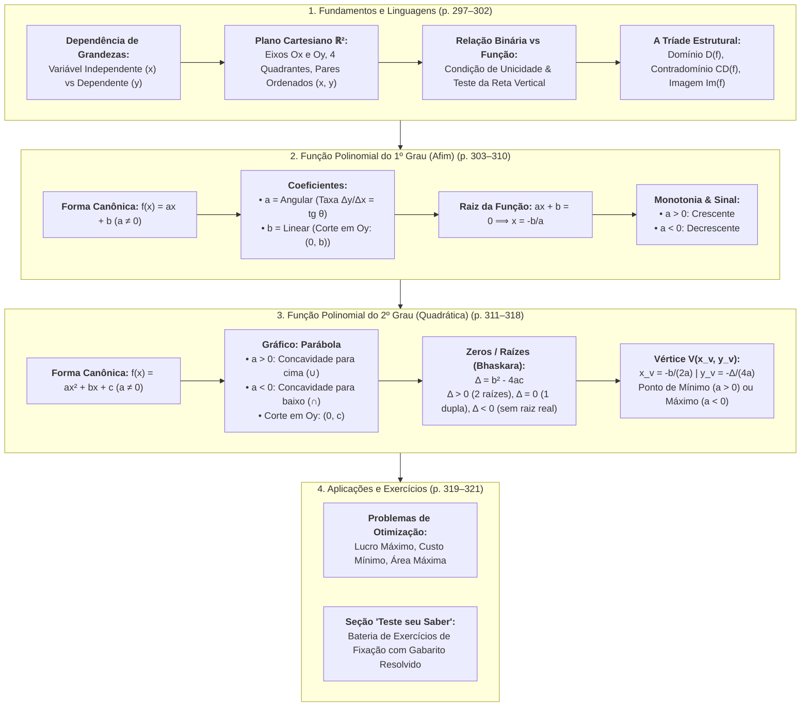
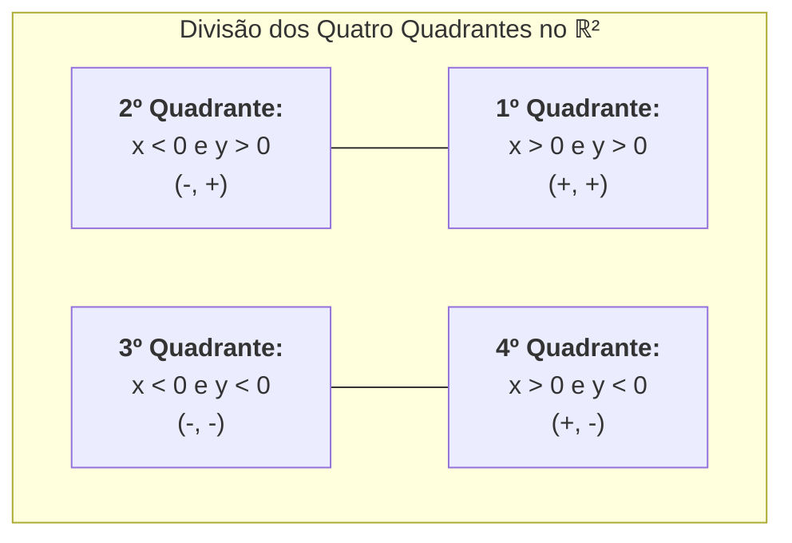
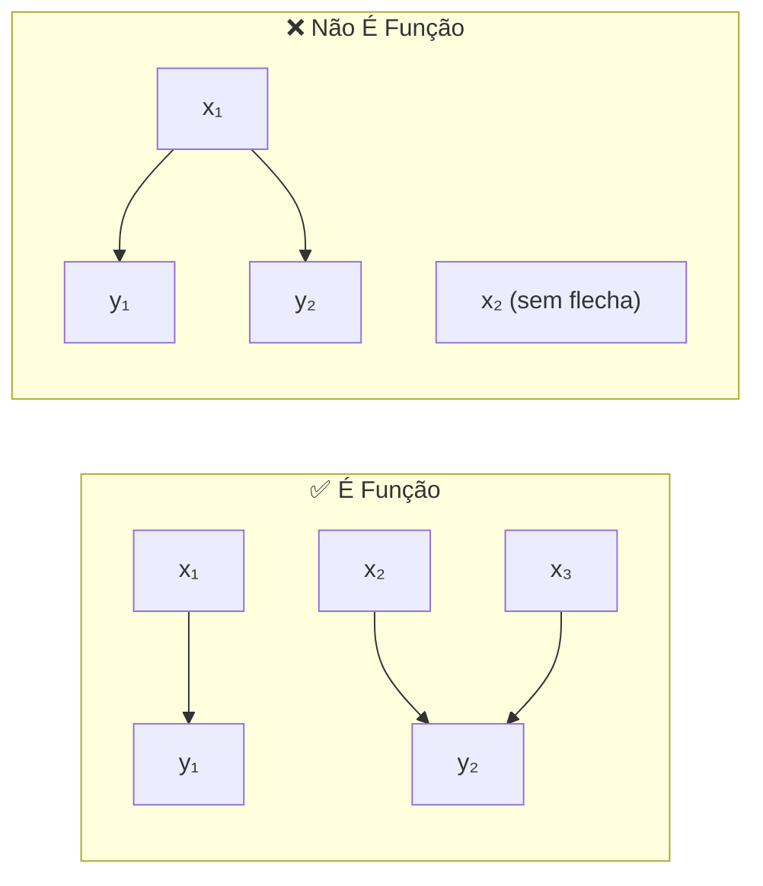
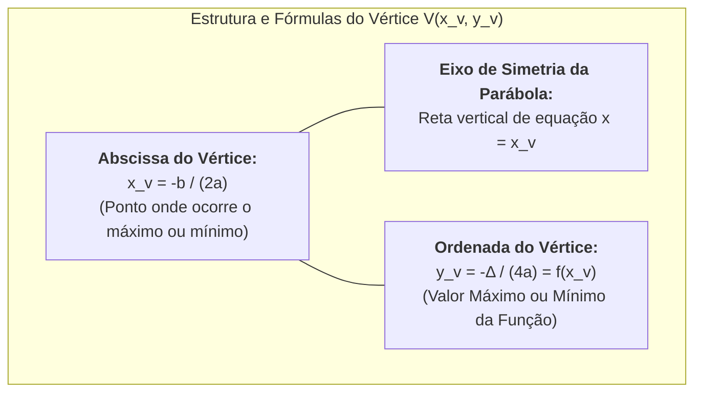

# 📖 Texto-base: Manual Compacto de Matemática — Funções: Conceito, Propriedades e Aplicações (Capítulo 15)

> **Referência Oficial:** BOSQUILHA, Alessandra; AMARAL, João Tomás do; MIRANDA, Mônica. **Manual compacto de matemática: ensino fundamental**. 3. ed. São Paulo: Rideel, 2010. (Capítulo 15: *"Funções: qual seu significado e aplicações?"*, p. 297–321).  
> **Link na Biblioteca Virtual da Univesp:** [Plataforma BVirtual (Pág. 297)](https://leitor.bvirtual.com.br/reader/182305/pdf/297)  
> **Disciplina:** Matemática Básica (`MMB002-EC-2026S2B2-T001`) — Semana 6  
> **Tema da Semana:** Funções de 1º e 2º Grau: Conceitos, Características e Representações Gráficas  
> **Status:** 🟢 **Síntese Teórica, Analítica e Prática Concluída**

---

## 🗺️ Mapa Conceitual Geral do Capítulo 15

---

# 📚 PARTE I: Fundamentos do Conceito de Função (p. 297–302)

## 📌 1. A Noção Intuitiva de Função e Interdependência

No cotidiano e nas ciências naturais e exatas, raramente os fenômenos ocorrem de forma isolada. Na maioria esmagadora dos casos, uma quantidade ou medida varia em virtude de outra:
* O valor cobrado na conta de água ou luz varia em função do consumo mensal medido no relógio medidor.
* O valor de uma corrida em veículo de transporte varia em função da quilometragem rodada e do tempo decorrido.
* A área de um terreno quadrado varia em função da medida de seu lado ($A = \ell^2$).
* O volume de uma esfera de metal varia em função do seu raio ($V = \frac{4}{3}\pi r^3$).

### 1.1. Variáveis Independentes e Variáveis Dependentes
Ao estabelecer a conexão entre duas grandezas correlacionadas:
1. **Variável Independente ($x$):** É a grandeza que pode ser fixada livremente a partir de um conjunto inicial (domínio). É o dado de entrada (*input*).
2. **Variável Dependente ($y$):** É a grandeza que tem seu valor rigorosamente determinado a partir do valor adotado pela variável independente. É o resultado produzido (*output*).

$$\text{Entrada } x \xrightarrow{\quad \text{Regra/Lei } f \quad} \text{Saída } y = f(x)$$

---

## 📌 2. O Plano Cartesiano e os Pares Ordenados

Para representar visualmente a correlação entre as variáveis, a matemática utiliza o sistema desenvolvido pelo filósofo e matemático francês **René Descartes** (1596–1650).

### 2.1. O Par Ordenado
Dados dois números $x$ e $y$, o agrupamento indicado por $(x, y)$ denomina-se **par ordenado**.
* A ordem dos termos é rígida: o primeiro termo ($x$) refere-se sempre ao eixo horizontal, e o segundo ($y$) ao eixo vertical.
* **Critério de Igualdade de Pares Ordenados:**
  $$(x_1, y_1) = (x_2, y_2) \iff x_1 = x_2 \quad \text{e} \quad y_1 = y_2$$
  *Portanto, $(3, 5) \neq (5, 3)$ no plano cartesiano.*

### 2.2. A Estrutura dos Quatro Quadrantes
Dois eixos graduados perpendiculares entre si interceptam-se na **Origem $O(0, 0)$**:
* **Eixo Horizontal ($Ox$):** Eixo das **Abscissas**.
* **Eixo Vertical ($Oy$):** Eixo das **Ordenadas**.

* **Pontos sobre os Eixos:**
  * Pertence ao eixo $Ox \iff y = 0 \implies (x, 0)$
  * Pertence ao eixo $Oy \iff x = 0 \implies (0, y)$

---

## 📌 3. Relação Binária versus Função

Nem toda relação entre dois conjuntos constitui uma função. O texto de Bosquilha et al. estabelece a distinção com precisão matemática:

### 3.1. Produto Cartesiano e Relação
Dados dois conjuntos não vazios $A$ e $B$:
* O **Produto Cartesiano** $A \times B$ é o conjunto de todos os pares ordenados possíveis:
  $$A \times B = \{(x, y) \mid x \in A \text{ e } y \in B\}$$
* Uma **relação binária** $R$ de $A$ em $B$ é qualquer subconjunto do produto cartesiano: $R \subseteq A \times B$.

### 3.2. As Duas Condições de Existência e Unicidade de uma Função
Uma relação binária $f$ de $A$ em $B$ é denominada **função de $A$ em $B$** ($f: A \to B$) se, e somente se, satisfaz simultaneamente:
1. **Condição de Existência (Não Sobra Elemento no Ponto de Partida):**  
   Para todo elemento $x \in A$, existe pelo menos um elemento $y \in B$ tal que $(x, y) \in f$.
2. **Condição de Unicidade (Não Há Duplicidade de Imagem):**  
   Se $(x, y_1) \in f$ e $(x, y_2) \in f$, então $y_1 = y_2$. Ou seja, de cada elemento do conjunto de partida $A$ parte **uma, e apenas uma, flecha** de correspondência.

> 🔍 **O Teste da Reta Vertical para Gráficos Cartesianos:**  
> Se for possível traçar qualquer reta vertical paralela ao eixo $y$ que cruze o gráfico em **dois ou mais pontos distintos**, a curva **não representa o gráfico de uma função**. Se toda reta vertical interceptar a curva em no máximo um ponto, a relação **é uma função**.

---

## 📌 4. A Tríade Estrutural: Domínio, Contradomínio e Conjunto Imagem

Dada uma função $f: A \to B$:
* **Domínio ($D(f)$):** É o conjunto de partida $A$. É o conjunto de todos os valores admissíveis para a variável independente $x$.
* **Contradomínio ($CD(f)$):** É o conjunto de chegada $B$. Representa o universo dentro do qual as imagens são procuradas.
* **Conjunto Imagem ($\text{Im}(f)$):** É o subconjunto do contradomínio formado exclusivamente pelos elementos $y \in B$ que efetivamente se associam a algum $x \in A$:
  $$\text{Im}(f) = \{y \in B \mid \exists x \in A \text{ tal que } y = f(x)\} \subseteq CD(f)$$

---

# 📚 PARTE II: Função Polinomial do 1º Grau (Função Afim) (p. 303–310)

## 📌 5. Definição Formal e Classificação

Uma função $f: \mathbb{R} \to \mathbb{R}$ denomina-se **função polinomial do 1º grau** (ou **função afim**) quando sua lei algébrica é dada por:

$$f(x) = ax + b \quad \text{com } a, b \in \mathbb{R} \text{ e } a \neq 0$$

* **$a$ (Coeficiente Angular ou Taxa de Variação):** Mede a declividade da reta em relação ao eixo horizontal. Representa a taxa constante de aumento ou diminuição de $y$ para cada acréscimo unitário em $x$.
* **$b$ (Coeficiente Linear ou Termo Independente):** Representa o valor fixo assumido por $y$ quando $x = 0$.

### 5.1. Casos Específicos e Nomenclatura

| Classificação | Condição dos Coeficientes | Lei Algébrica | Características Gráficas |
| :--- | :---: | :---: | :--- |
| **Afim Completa** | $a \neq 0$ e $b \neq 0$ | $f(x) = ax + b$ | Reta inclinada que não passa pela origem. |
| **Linear** | $a \neq 0$ e $b = 0$ | $f(x) = ax$ | Reta inclinada que **passa obrigatoriamente pela Origem $(0, 0)$**. Modela relações de proporcionalidade direta. |
| **Identidade** | $a = 1$ e $b = 0$ | $f(x) = x$ | Bissetriz dos quadrantes ímpares (1º e 3º quadrantes). Cada ponto tem $y = x$. |
| **Constante** | $a = 0$ ($a$ nulo) | $f(x) = b$ | Reta perfeitamente horizontal na ordenada $y = b$. (Não é de 1º grau, é grau zero). |

---

## 📌 6. Raiz (ou Zero) da Função Afim

A **raiz** ou **zero** de uma função afim é o número real $x$ que anula o valor da função:

$$f(x) = 0 \iff ax + b = 0 \iff ax = -b \iff x = -\frac{b}{a}$$

### 6.1. Significado Geométrico dos Pontos Notáveis
O gráfico de uma função afim fica perfeitamente determinado pelos seus dois pontos de intersecção com os eixos coordenados:
1. **Corte com o Eixo das Ordenadas ($Oy$):** Fazendo $x = 0 \implies y = f(0) = b \implies \mathbf{P_y(0, b)}$.
2. **Corte com o Eixo das Abscissas ($Ox$):** Fazendo $y = 0 \implies x = -\frac{b}{a} \implies \mathbf{P_x\left(-\frac{b}{a}, 0\right)}$.

---

## 📌 7. Monotonia e Estudo do Sinal da Função Afim

### 7.1. Crescimento e Decrescimento
A variação da função afim é uniforme e governada unicamente pelo sinal do coeficiente angular $a$:
* **Se $a > 0$:** A função é **estritamente crescente**. À medida que $x$ aumenta, $f(x)$ também aumenta.
  $$x_1 < x_2 \implies f(x_1) < f(x_2)$$
* **Se $a < 0$:** A função é **estritamente decrescente**. À medida que $x$ aumenta, $f(x)$ diminui.
  $$x_1 < x_2 \implies f(x_1) > f(x_2)$$

### 7.2. O Estudo do Sinal
Estudar o sinal de uma função consiste em determinar para quais valores de $x$ a função é positiva ($f(x) > 0$), nula ($f(x) = 0$) ou negativa ($f(x) < 0$):

| Intervalo de $x$ | Caso $a > 0$ (Crescente) | Caso $a < 0$ (Decrescente) |
| :---: | :---: | :---: |
| $x < -\frac{b}{a}$ | $f(x) < 0$ (Abaixo do eixo $x$) | $f(x) > 0$ (Acima do eixo $x$) |
| $x = -\frac{b}{a}$ | $f(x) = 0$ (Raiz no eixo $x$) | $f(x) = 0$ (Raiz no eixo $x$) |
| $x > -\frac{b}{a}$ | $f(x) > 0$ (Acima do eixo $x$) | $f(x) < 0$ (Abaixo do eixo $x$) |

---

# 📚 PARTE III: Função Polinomial do 2º Grau (Função Quadrática) (p. 311–318)

## 📌 8. Definição Formal e Gráfico Parabólico

Denomina-se **função polinomial do 2º grau** ou **função quadrática** toda função $f: \mathbb{R} \to \mathbb{R}$ definida pela lei:

$$f(x) = ax^2 + bx + c \quad \text{com } a, b, c \in \mathbb{R} \text{ e } a \neq 0$$

* O gráfico de uma função quadrática no plano cartesiano é uma curva contínua, aberta e simétrica denominada **parábola**.

### 8.1. O Papel dos Coeficientes $a$, $b$ e $c$

1. **Coeficiente $a$ (Direção da Concavidade e Abertura):**
   * **Se $a > 0$:** A parábola tem a **concavidade voltada para cima** ($\cup$). A função atinge um ponto de **mínimo absoluto**.
   * **Se $a < 0$:** A parábola tem a **concavidade voltada para baixo** ($\cap$). A função atinge um ponto de **máximo absoluto**.
   * Quanto maior o valor absoluto $|a|$, mais "estreita" é a abertura dos ramos da parábola.
2. **Coeficiente $b$ (Inclinação no Corte com $Oy$):**
   * Indica a direção com que a parábola intercepta o eixo vertical $y$:
     * $b > 0$: A parábola cruza o eixo $y$ em sentido **crescente** (subindo).
     * $b < 0$: A parábola cruza o eixo $y$ em sentido **decrescente** (descendo).
     * $b = 0$: O eixo $y$ coincide com o eixo de simetria da parábola; o vértice está exatamente sobre o eixo $y$.
3. **Coeficiente $c$ (Termo Independente e Intersecção com $Oy$):**
   * Como $f(0) = a(0)^2 + b(0) + c = c$, o ponto de corte com o eixo vertical é rigorosamente:
     $$\mathbf{P_y(0, c)}$$

---

## 📌 9. Raízes da Função Quadrática e Análise do Discriminante ($\Delta$)

As raízes (ou zeros) da função quadrática são os valores de $x$ que satisfazem a equação de 2º grau:

$$ax^2 + bx + c = 0$$

Pela fórmula resolutiva de Bhaskara:
$$\Delta = b^2 - 4ac \quad \text{e} \quad x = \frac{-b \pm \sqrt{\Delta}}{2a}$$

O valor do discriminante ($\Delta$) dita a quantidade e a natureza das raízes reais, determinando geometricamente quantas vezes a parábola toca o eixo horizontal $Ox$:

| Discriminante | Raízes Reais | Posição Geométrica em Relação ao Eixo $Ox$ |
| :---: | :--- | :--- |
| **$\Delta > 0$** | **Duas raízes reais e distintas** ($x_1 \neq x_2$): $x_1 = \frac{-b - \sqrt{\Delta}}{2a}, \; x_2 = \frac{-b + \sqrt{\Delta}}{2a}$ | A parábola **corta o eixo $Ox$ em dois pontos distintos**: $(x_1, 0)$ e $(x_2, 0)$. |
| **$\Delta = 0$** | **Duas raízes reais e iguais** ($x_1 = x_2$): $x = -\frac{b}{2a}$ | A parábola é **tangente ao eixo $Ox$** em um único ponto, que coincide com o vértice. |
| **$\Delta < 0$** | **Não possui raízes reais** ($\nexists x \in \mathbb{R}$) (As raízes são números complexos conjugados). | A parábola **não intercepta nem tangencia o eixo $Ox$** (permanece inteiramente acima ou inteiramente abaixo do eixo). |

---

## 📌 10. O Vértice da Parábola e Problemas de Otimização

O **Vértice $V(x_v, y_v)$** é o ponto de inflexão e simetria da parábola, constituindo a ferramenta primordial para resolver problemas de maximização e minimização no cálculo elementar.

### 10.1. Dedução Analítica da Abscissa do Vértice
Como a parábola é perfeitamente simétrica em relação à reta vertical que passa pelo vértice, $x_v$ situa-se no ponto médio aritmético das duas raízes reais:
$$x_v = \frac{x_1 + x_2}{2} = \frac{\frac{-b - \sqrt{\Delta}}{2a} + \frac{-b + \sqrt{\Delta}}{2a}}{2} = \frac{-\frac{2b}{2a}}{2} = -\frac{b}{2a}$$

### 10.2. Máximo versus Mínimo e o Conjunto Imagem
* **Se $a > 0$ (Concavidade para cima):**
  * O vértice $V$ é o ponto de **Mínimo Absoluto**.
  * A função atinge seu **valor mínimo** em $y_{\text{mín}} = y_v = -\frac{\Delta}{4a}$.
  * **Conjunto Imagem:** $\text{Im}(f) = [y_v, +\infty[ = \{y \in \mathbb{R} \mid y \geq y_v\}$.
* **Se $a < 0$ (Concavidade para baixo):**
  * O vértice $V$ é o ponto de **Máximo Absoluto**.
  * A função atinge seu **valor máximo** em $y_{\text{máx}} = y_v = -\frac{\Delta}{4a}$.
  * **Conjunto Imagem:** $\text{Im}(f) = ]-\infty, y_v] = \{y \in \mathbb{R} \mid y \leq y_v\}$.

---

## 📌 11. Estudo do Sinal da Função Quadrática: Os Seis Casos Canônicos

A determinação do sinal de $y = ax^2 + bx + c$ depende do sinal conjunto de $a$ e de $\Delta$:

| Caso | Parâmetros | Esboço do Comportamento dos Sinais |
| :---: | :---: | :--- |
| **1** | $a > 0$ e $\Delta > 0$ | $f(x) > 0$ para $x < x_1$ ou $x > x_2$; $f(x) = 0$ em $x_1$ e $x_2$; $f(x) < 0$ para $x_1 < x < x_2$ (entre as raízes). |
| **2** | $a > 0$ e $\Delta = 0$ | $f(x) > 0$ para todo $x \neq x_v$; $f(x) = 0$ exclusivamente no vértice $x = x_v$. A função nunca é negativa. |
| **3** | $a > 0$ e $\Delta < 0$ | $f(x) > 0$ estritamente para **todo** $x \in \mathbb{R}$. A curva situa-se integralmente acima do eixo $Ox$. |
| **4** | $a < 0$ e $\Delta > 0$ | $f(x) < 0$ para $x < x_1$ ou $x > x_2$; $f(x) = 0$ em $x_1$ e $x_2$; $f(x) > 0$ para $x_1 < x < x_2$ (entre as raízes). |
| **5** | $a < 0$ e $\Delta = 0$ | $f(x) < 0$ para todo $x \neq x_v$; $f(x) = 0$ exclusivamente no vértice $x = x_v$. A função nunca é positiva. |
| **6** | $a < 0$ e $\Delta < 0$ | $f(x) < 0$ estritamente para **todo** $x \in \mathbb{R}$. A curva situa-se integralmente abaixo do eixo $Ox$. |

> 💡 **Regra Mnemônica Prática:**  
> Quando $\Delta > 0$, o sinal de $f(x)$ **fora das raízes** coincide com o **sinal de $a$**; **entre as raízes**, o sinal de $f(x)$ é o **sinal oposto ao de $a$**.

---

# 📚 PARTE IV: Aplicações Práticas e Modelagem (p. 319–320)

## 📌 12. Modelagem de Problemas Clássicos de Otimização

### 12.1. Problema da Área Máxima com Cercado Retangular
> **Enunciado:** Um agricultor possui $120\text{ metros}$ de cerca e deseja cercar um terreno retangular adjacente a uma parede reta de alvenaria (não sendo necessário cercar o lado encostado na parede). Quais devem ser as dimensões do terreno para que a área delimitada seja máxima?

* **Modelagem:**
  * Sejam $x$ a medida dos dois lados perpendiculares à parede e $y$ a medida do lado paralelo à parede.
  * Comprimento total da cerca disponível: $2x + y = 120 \implies y = 120 - 2x$.
  * Área do retângulo em função de $x$:
    $$A(x) = x \cdot y = x(120 - 2x) = -2x^2 + 120x$$
* **Identificação dos Coeficientes:**
  * $a = -2$, $b = 120$, $c = 0$.
  * Como $a = -2 < 0$, a concavidade é voltada para baixo, admitindo ponto de **máximo**.
* **Cálculo da Dimensão Ótima ($x_v$):**
  $$x_v = -\frac{b}{2a} = -\frac{120}{2(-2)} = \frac{120}{4} = 30\text{ metros}$$
* **Cálculo do Outro Lado ($y$) e da Área Máxima ($A_{\text{máx}}$):**
  $$y = 120 - 2(30) = 60\text{ metros}$$
  $$A_{\text{máx}} = 30 \times 60 = 1.800\text{ m}^2$$
  *(Ou aplicando diretamente a fórmula: $A_{\text{máx}} = -\frac{\Delta}{4a} = -\frac{120^2 - 4(-2)(0)}{4(-2)} = -\frac{14.400}{-8} = 1.800\text{ m}^2$)*.

---

### 12.2. Problema de Balística: Altura Máxima de um Lançamento
> **Enunciado:** Um projétil é lançado verticalmente para cima a partir do solo. Sua altura $h$ em metros após $t$ segundos de voo é dada por:
> $$h(t) = -5t^2 + 40t$$
> Pede-se: a) O tempo necessário para atingir a altura máxima; b) A altura máxima alcançada; c) O tempo total de permanência no ar.

* **Resolução Analítica:**
  1. **Tempo para Altura Máxima ($t_v$):**
     $$t_v = -\frac{b}{2a} = -\frac{40}{2(-5)} = \frac{40}{10} = 4\text{ segundos}$$
  2. **Altura Máxima ($h_{\text{máx}}$):**
     $$h(4) = -5(4)^2 + 40(4) = -5(16) + 160 = -80 + 160 = 80\text{ metros}$$
  3. **Tempo Total de Voo (Retorno ao Solo):**
     O projétil atinge o solo quando $h(t) = 0$:
     $$-5t^2 + 40t = 0 \iff -5t(t - 8) = 0 \implies t_1 = 0\text{ s (lançamento)} \quad \text{e} \quad t_2 = 8\text{ s (queda)}$$
     *O tempo total no ar é de $8\text{ segundos}$ (o dobro do tempo de subida pela simetria da parábola).*

---

# 📚 PARTE V: Bateria "Teste seu Saber" Resolvida Passo a Passo (p. 320–321)

### 📝 Questão 1: Determinação de Lei Afim a Partir de Pontos
**Enunciado:** Uma função afim $f(x) = ax + b$ satisfaz as condições $f(2) = 5$ e $f(-1) = -4$. Determine a lei dessa função, sua raiz e seu valor para $x = 10$.

* **Resolução:**
  Montando o sistema linear com as duas informações:
  $$\begin{cases} f(2) = 2a + b = 5 \\ f(-1) = -a + b = -4 \end{cases}$$
  Subtraindo a segunda equação da primeira:
  $$(2a + b) - (-a + b) = 5 - (-4) \implies 3a = 9 \implies a = 3$$
  Substituindo $a = 3$ na primeira equação:
  $$2(3) + b = 5 \implies 6 + b = 5 \implies b = -1$$
  * **Lei da Função:** $f(x) = 3x - 1$
  * **Raiz:** $3x - 1 = 0 \implies x = \frac{1}{3}$
  * **Valor para $x = 10$:** $f(10) = 3(10) - 1 = 30 - 1 = 29$.

---

### 📝 Questão 2: Estudo de Custo e Preço de Venda
**Enunciado:** Uma pequena fábrica tem um custo mensal fixo de R$ 2.400,00 mais um custo de produção variável de R$ 15,00 por unidade de mercadoria produzida. Sabendo que cada unidade é vendida a R$ 25,00:
a) Escreva a lei da função custo total $C(x)$ e da receita total $R(x)$.
b) Escreva a lei da função lucro mensal $L(x)$.
c) Quantas unidades precisam ser vendidas no mínimo para que a empresa comece a ter lucro real (ponto de equilíbrio)?

* **Resolução:**
  a) $C(x) = 15x + 2.400$ e $R(x) = 25x$.  
  b) Lucro = Receita - Custo:
     $$L(x) = R(x) - C(x) = 25x - (15x + 2.400) = 10x - 2.400$$
  c) No ponto de equilíbrio (*break-even point*), o lucro é nulo ($L(x) = 0$):
     $$10x - 2.400 = 0 \implies 10x = 2.400 \implies x = 240\text{ unidades}$$
     *A empresa precisa produzir e vender mais de 240 unidades para obter lucro positivo.*

---

### 📝 Questão 3: Vértice e Imagem de Função Quadrática
**Enunciado:** Dada a função quadrática $f(x) = x^2 - 6x + 5$:
a) Determine suas raízes reais.
b) Calcule as coordenadas do vértice e indique se é ponto de máximo ou mínimo.
c) Determine o conjunto imagem $\text{Im}(f)$.
d) Faça o estudo do sinal da função.

* **Resolução:**
  Identificação dos coeficientes: $a = 1, b = -6, c = 5$.
  * **a) Raízes:**
    $$\Delta = (-6)^2 - 4(1)(5) = 36 - 20 = 16$$
    $$x = \frac{-(-6) \pm \sqrt{16}}{2(1)} = \frac{6 \pm 4}{2} \implies x_1 = 1, \quad x_2 = 5$$
  * **b) Vértice:**
    $$x_v = -\frac{b}{2a} = -\frac{-6}{2(1)} = 3$$
    $$y_v = -\frac{\Delta}{4a} = -\frac{16}{4(1)} = -4$$
    Como $a = 1 > 0$, a concavidade é para cima e $V(3, -4)$ é um **ponto de mínimo**.
  * **c) Conjunto Imagem:**
    $$\text{Im}(f) = [-4, +\infty[ = \{y \in \mathbb{R} \mid y \geq -4\}$$
  * **d) Estudo do Sinal:**
    * $f(x) > 0$ para $x < 1$ ou $x > 5$
    * $f(x) = 0$ para $x = 1$ e $x = 5$
    * $f(x) < 0$ para $1 < x < 5$

---

# 📊 Síntese Geral de Fórmulas e Relações Fundamentais

| Tópico | Função de 1º Grau (Afim) | Função de 2º Grau (Quadrática) |
| :--- | :---: | :---: |
| **Lei Canônica** | $f(x) = ax + b$ ($a \neq 0$) | $f(x) = ax^2 + bx + c$ ($a \neq 0$) |
| **Gráfico** | Reta | Parábola |
| **Comportamento Gráfico** | $a > 0$: Crescente $a < 0$: Decrescente | $a > 0$: Concavidade para cima ($\cup$) $a < 0$: Concavidade para baixo ($\cap$) |
| **Intersecção com Eixo $Oy$** | $(0, b)$ | $(0, c)$ |
| **Raízes / Zeros** | $x = -\frac{b}{a}$ (Exatamente 1 raiz) | $x = \frac{-b \pm \sqrt{b^2 - 4ac}}{2a}$ (2, 1 ou 0 raízes reais) |
| **Intersecção com Eixo $Ox$** | $\left(-\frac{b}{a}, 0\right)$ | $(x_1, 0)$ e $(x_2, 0)$ (quando $\Delta \geq 0$) |
| **Extremos (Máximo / Mínimo)** | Não possui (continua ao infinito) | Vértice $V(x_v, y_v)$ com: $x_v = -\frac{b}{2a}, \quad y_v = -\frac{\Delta}{4a}$ |
| **Conjunto Imagem** | $\text{Im} = \mathbb{R}$ | $\text{Im} = [y_v, +\infty[$ ($a > 0$) $\text{Im} = ]-\infty, y_v]$ ($a < 0$) |
| **Eixo de Simetria** | Não possui | Reta vertical $x = -\frac{b}{2a}$ |
