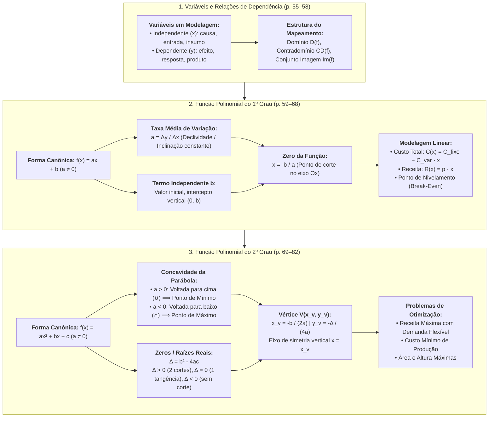
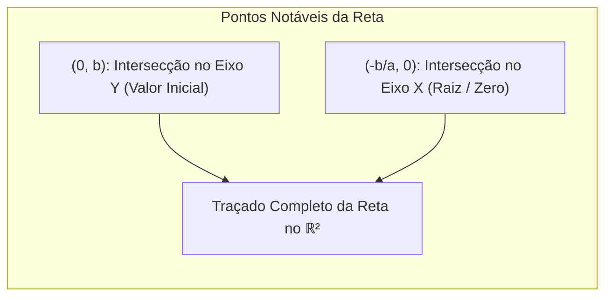
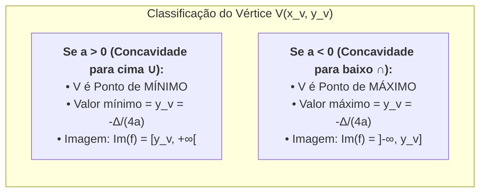

# 📖 Texto-base: Fundamentos de Matemática — Variáveis, Função de 1º Grau e Função de 2º Grau (Capítulos 4 e 5, p. 55–82)

> **Referência Oficial:** ARAUJO, Luciana Maria Margoti; FERRAZ, Mariana Sacrini Ayres; LOYO, Tiago; STEFANI, Rafael; PARENTI, Tatiana Marques da Silva. **Fundamentos de matemática**. Porto Alegre: Grupo A / SAGAH, 2018.  
> * Capítulos abordados: *"Variáveis matemáticas e função de primeiro grau"* (p. 55–68) e *"Função do segundo grau"* (p. 69–82).  
> **Link na Minha Biblioteca:** [Plataforma Minha Biblioteca SAGAH (Pág. 54/55)](https://app.minhabiblioteca.com.br/reader/books/9788595027701/pageid/54)  
> **Disciplina:** Matemática Básica (`MMB002-EC-2026S2B2-T001`) — Semana 6  
> **Tema da Semana:** Funções: Conceitos e Representações (Funções de 1º e 2º Grau)  
> **Status:** 🟢 **Síntese Teórica, Analítica e Aplicada Concluída**

---

## 🗺️ Mapa Conceitual Integrado dos Capítulos (Araujo et al., p. 55–82)

---

# 📚 PARTE I: Variáveis Matemáticas e Função de Primeiro Grau (p. 55–68)

## 📌 1. Variáveis e Relações de Dependência

No enfoque didático de Araújo et al. (SAGAH), a abordagem de funções é orientada à **modelagem matemática aplicada**: a transição da álgebra instrumental para a resolução de problemas práticos nas engenharias, na computação e na gestão econômica.

### 1.1. O Conceito de Função na Prática
Uma função expressa como uma grandeza de saída depende univocamente de uma ou mais grandezas de entrada:
* **Variável Independente ($x$):** Representa o valor que assume livremente valores dentro de um conjunto pré-determinado (o **Domínio** $D(f)$).
* **Variável Dependente ($y$ ou $f(x)$):** Representa a resposta numérica obtida exclusivamente após a aplicação da lei matemática sobre o elemento de entrada $x$. Pertence ao **Conjunto Imagem** $\text{Im}(f) \subseteq CD(f)$.

> [!NOTE]
> **A Regra de Ouro da Modelagem:**  
> Cada valor de entrada $x$ deve produzir **um e apenas um** valor de saída $y$. Se um mesmo valor de entrada gerasse dois custos de produção distintos em condições idênticas, a relação não modelaria um sistema determinístico e violaria o princípio de função.

---

## 📌 2. Função Polinomial do Primeiro Grau (Função Afim)

### 2.1. Definição Geral e Significado dos Coeficientes
Denomina-se **função de primeiro grau** toda função da forma:

$$f(x) = ax + b \quad \text{com } a, b \in \mathbb{R} \text{ e } a \neq 0$$

* **$a$ (Coeficiente Angular ou Taxa de Variação):**
  Representa a **taxa marginal** com que a variável dependente varia quando a variável independente sofre um acréscimo unitário:
  $$a = \frac{\Delta y}{\Delta x} = \frac{f(x_2) - f(x_1)}{x_2 - x_1}$$
  * Se $a > 0$: A função é **crescente** (aumento em $x$ gera aumento proporcional em $y$).
  * Se $a < 0$: A função é **decrescente** (aumento em $x$ gera redução proporcional em $y$).
* **$b$ (Coeficiente Linear ou Ponto Inicial):**
  Representa o valor da função no ponto em que $x = 0$, correspondendo geometricamente ao ponto onde a reta cruza o eixo vertical das ordenadas:
  $$P_y = (0, b)$$

---

## 📌 3. Gráficos, Raízes e Intersecções

O gráfico de uma função afim é invariavelmente uma **linha reta**.

### 3.1. Determinação da Raiz (Zero da Função)
A raiz é o valor de $x$ que anula a expressão:
$$f(x) = 0 \iff ax + b = 0 \iff x = -\frac{b}{a}$$
* Geometricamente, corresponde ao ponto de corte no eixo horizontal das abscissas: $P_x = \left(-\frac{b}{a}, 0\right)$.

---

## 📌 4. Aplicações Práticas: Modelos Econômicos Lineares

A obra de Araújo et al. enfatiza a modelagem de custos, receitas e lucros em empresas e sistemas produtivos:

### 4.1. Função Custo Total ($C(x)$)
O custo total de operação é decomposto em uma parcela fixa e uma parcela variável proporcional à quantidade produzida $x$:
$$C(x) = C_f + C_v \cdot x$$
* $C_f = b$: Custo Fixo (aluguel, maquinário, salários administrativos). Ocorre mesmo se $x = 0$.
* $C_v = a$: Custo Marginal Variável unitário (matéria-prima, energia direta por unidade).

### 4.2. Função Receita Total ($R(x)$)
Se cada unidade for comercializada ao preço fixo de venda $p$:
$$R(x) = p \cdot x$$
*(Trata-se de uma função linear com $b = 0$, que parte da origem $(0, 0)$).*

### 4.3. Função Lucro Total ($L(x)$) e o Ponto de Nivelamento (*Break-Even Point*)
O lucro é a diferença líquida entre a receita total e o custo total:
$$L(x) = R(x) - C(x) = p \cdot x - (C_v \cdot x + C_f) = (p - C_v)x - C_f$$
* O termo $(p - C_v)$ denomina-se **Margem de Contribuição Unitária**.
* O **Ponto de Equilíbrio** ocorre quando o lucro é nulo ($L(x) = 0 \iff R(x) = C(x)$):
  $$x_{\text{eq}} = \frac{C_f}{p - C_v}$$
  * Se $x < x_{\text{eq}}$: A empresa opera com **prejuízo** ($L(x) < 0$).
  * Se $x = x_{\text{eq}}$: Não há lucro nem prejuízo (custos amortizados).
  * Se $x > x_{\text{eq}}$: A empresa opera na faixa de **lucro positivo** ($L(x) > 0$).

---

# 📚 PARTE II: Função do Segundo Grau (Função Quadrática) (p. 69–82)

## 📌 5. Definição Formal e Gráfico

Uma **função polinomial do 2º grau** é toda relação definida por:

$$f(x) = ax^2 + bx + c \quad \text{com } a, b, c \in \mathbb{R} \text{ e } a \neq 0$$

* O gráfico cartesiano é uma curva contínua dotada de simetria axial denominada **parábola**.

### 5.1. A Concavidade
O coeficiente dominante $a$ governa a concavidade da parábola:
* **$a > 0$:** Ramos voltados para cima ($\cup$). A função decresce até atingir um **ponto de mínimo global** no vértice e, em seguida, passa a crescer.
* **$a < 0$:** Ramos voltados para baixo ($\cap$). A função cresce até atingir um **ponto de máximo global** no vértice e, em seguida, passa a decrescer.

---

## 📌 6. Zeros da Função Quadrática e a Análise do Discriminante ($\Delta$)

As raízes da função quadrática são calculadas igualando $f(x)$ a zero:
$$ax^2 + bx + c = 0$$

Utilizando a fórmula resolutiva de Bhaskara:
$$\Delta = b^2 - 4ac \quad \text{e} \quad x = \frac{-b \pm \sqrt{\Delta}}{2a}$$

| Sinal de $\Delta$ | Número de Raízes Reais | Relação Geométrica com o Eixo $Ox$ |
| :---: | :---: | :--- |
| **$\Delta > 0$** | 2 raízes distintas ($x_1 \neq x_2$) | A parábola **intercepta o eixo $Ox$ em dois pontos**: $(x_1, 0)$ e $(x_2, 0)$. |
| **$\Delta = 0$** | 1 raiz real dupla ($x_1 = x_2$) | A parábola **tangencia o eixo $Ox$** no vértice: $\left(-\frac{b}{2a}, 0\right)$. |
| **$\Delta < 0$** | Nenhuma raiz real ($\nexists x \in \mathbb{R}$) | A parábola **não toca o eixo $Ox$** (está suspensa acima ou imersa abaixo do eixo). |

---

## 📌 7. O Vértice da Parábola e Problemas de Otimização

O vértice $V(x_v, y_v)$ é o ponto mais relevante da função quadrática em termos de engenharia e negócios, pois define o ponto crítico onde ocorrem os valores extremos.

### 7.1. Fórmulas Canônicas do Vértice
$$x_v = -\frac{b}{2a} \quad \text{e} \quad y_v = -\frac{\Delta}{4a} = f(x_v)$$

* **Abscissa do Vértice ($x_v$):** Indica **onde** ou **para qual quantidade/tempo** o fenômeno atinge sua condição ótima (quantidade de unidades a fabricar, tempo de voo para altura máxima, etc.).
* **Ordenada do Vértice ($y_v$):** Indica **qual é o valor ótimo atingido** (o valor do lucro máximo em reais, o custo mínimo em reais, a altura máxima em metros, etc.).

---

## 📌 8. Modelagem de Receita com Preço Dependente da Demanda

Um dos problemas mais clássicos destacados por Araújo et al. é quando o preço unitário $p$ não é constante, mas diminui conforme a quantidade produzida e ofertada aumenta (lei linear de demanda):

$$p(x) = p_0 - k \cdot x$$

* Multiplicando o preço pela quantidade vendida $x$, a **Função Receita** torna-se estritamente quadrática:
  $$R(x) = x \cdot p(x) = x(p_0 - kx) = -k x^2 + p_0 x$$
* Como o coeficiente $a = -k < 0$, a concavidade é voltada para baixo. O ponto de receita máxima ocorre em:
  $$x_{\text{ótimo}} = -\frac{b}{2a} = -\frac{p_0}{2(-k)} = \frac{p_0}{2k}$$
* A receita máxima alcançada é $R_{\text{máx}} = R(x_{\text{ótimo}}) = -\frac{\Delta}{4a}$.

---

# 📚 PARTE III: Exercícios Resolvidos Selecionados (SAGAH)

### 📝 Problema 1: Dimensionamento de Frota e Custo de Transporte
**Contexto:** Uma empresa de logística estima que o custo total diário em reais para operar uma frota de entregas é modelado pela função $C(x) = 18x + 4.500$, onde $x$ é a quantidade total de pacotes entregues no dia. Se a empresa cobra uma taxa fixa de entrega de R$ 33,00 por pacote:
1. Determine a função Lucro diário $L(x)$.
2. Calcule o número mínimo de entregas diárias para que a frota cubra seus custos operacionais.
3. Se forem entregues 500 pacotes em determinado dia, qual será o lucro líquido auferido?

* **Resolução:**
  1. $R(x) = 33x$.  
     $$L(x) = R(x) - C(x) = 33x - (18x + 4.500) = 15x - 4.500$$
  2. Ponto de Equilíbrio ($L(x) = 0$):
     $$15x - 4.500 = 0 \implies 15x = 4.500 \implies x = \frac{4.500}{15} = 300\text{ pacotes}$$
     *A empresa precisa realizar no mínimo 300 entregas para não operar no prejuízo.*
  3. Para $x = 500$:
     $$L(500) = 15(500) - 4.500 = 7.500 - 4.500 = \text{R\$ } 3.000{,}00$$

---

### 📝 Problema 2: Otimização de Lucro Quadrático em Linha de Produção
**Contexto:** A produção diária de um componente de hardware gera um lucro em reais modelado pela função quadrática:
$$L(q) = -2q^2 + 160q - 1.400$$
onde $q$ é a quantidade de unidades fabricadas por lote.
1. Quantas peças devem ser fabricadas por lote para atingir o lucro diário máximo?
2. Qual é o valor desse lucro máximo?
3. Quais são as quantidades de peças que geram ponto de nivelamento ($L(q) = 0$)?

* **Resolução:**
  Identificação dos coeficientes: $a = -2, b = 160, c = -1.400$.
  1. Quantidade ótima ($q_v$):
     $$q_v = -\frac{b}{2a} = -\frac{160}{2(-2)} = \frac{160}{4} = 40\text{ peças}$$
  2. Lucro máximo ($L(40)$ ou $y_v$):
     $$L(40) = -2(40)^2 + 160(40) - 1.400 = -2(1.600) + 6.400 - 1.400 = -3.200 + 6.400 - 1.400 = \text{R\$ } 1.800{,}00$$
  3. Raízes ($L(q) = 0$):
     $$\Delta = 160^2 - 4(-2)(-1.400) = 25.600 - 11.200 = 14.400$$
     $$\sqrt{\Delta} = \sqrt{14.400} = 120$$
     $$q = \frac{-160 \pm 120}{2(-2)} = \frac{-160 \pm 120}{-4}$$
     $$q_1 = \frac{-160 + 120}{-4} = \frac{-40}{-4} = 10\text{ peças}$$
     $$q_2 = \frac{-160 - 120}{-4} = \frac{-280}{-4} = 70\text{ peças}$$
     *A empresa cobre os custos a partir de 10 peças e entra novamente no prejuízo se produzir mais de 70 peças (devido à capacidade ociosa ou saturação de estoques).*

---

# 📊 Síntese Comparativa: Bosquilha et al. versus Araújo et al.

| Dimensão Pedagógica | Manual Compacto (Bosquilha et al., Rideel) | Fundamentos de Matemática (Araújo et al., SAGAH) |
| :--- | :--- | :--- |
| **Abordagem Central** | Estruturalista, axiomática, cartesiana e mnemônica. | Aplicada, instrumental, voltada para modelagem de negócios e engenharia. |
| **Ênfase na Função de 1º Grau** | Relação binária, produto cartesiano, estudo formal do sinal e inequações. | Custo fixo versus variável, ponto de nivelamento (*break-even point*) e taxa marginal. |
| **Ênfase na Função de 2º Grau** | 6 casos canônicos de sinais, parábola detalhada, simetria e Bhaskara rigoroso. | Otimização econômica, preço de demanda elástica, maximização de receita e lucro. |
| **Papel do Vértice** | Ponto de inversão geométrica da curva no plano cartesiano. | Variável de decisão gerencial ($x_v$) e resultado financeiro ótimo ($y_v$). |
