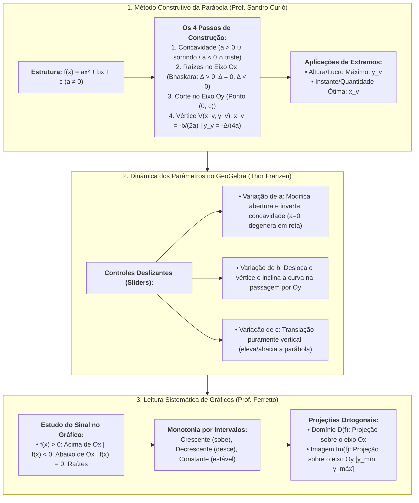
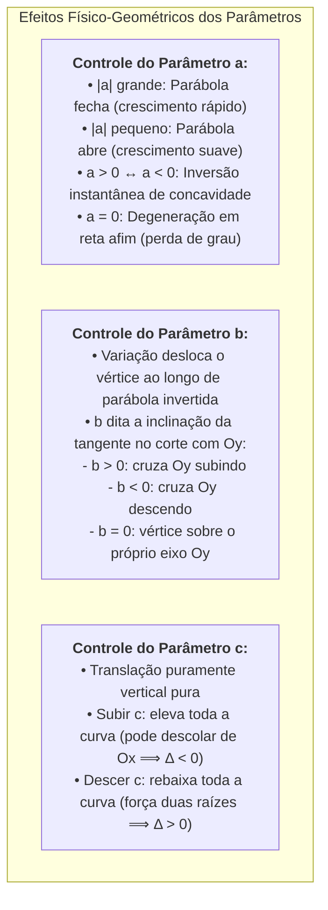
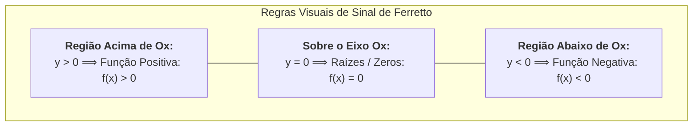

# 🌐 Material-base e Vídeos-base: Análise Gráfica de Funções e a Parábola

> **Disciplina:** Matemática Básica (`MMB002-EC-2026S2B2-T001`) — Semana 6  
> **Tema da Semana:** Funções: Conceitos, Representações e Modelagem (1º e 2º Grau)  
> **Composição do Material:**  
> 1. 🎬 **Vídeo-base 1:** *Função do 2º grau: fácil e rápido* | Prof. Sandro Curió (Dicasdemat)  
> 2. 🧮 **Material Interativo:** *Função de segundo grau* | Thor Franzen (GeoGebra)  
> 3. 🎬 **Vídeo-base 2:** *Funções: analisando o gráfico de funções* | Prof. Daniel Ferretto  
> **Status:** 🟢 **Síntese Teórica, Algorítmica e Gráfica Integrada**

---

## 🗺️ Visão Integrada dos Recursos de Apoio da Semana 6

---

## 🎬 1. Vídeo-base: Função do 2º Grau: Fácil e Rápido (Prof. Sandro Curió)

* **Canal / Docente:** Prof. Sandro Curió (*Dicasdemat*)  
* **Link Oficial:** [YouTube (ZpW9Xb5iyt4)](https://www.youtube.com/watch?v=ZpW9Xb5iyt4)  
* **Sinopse Oficial (AVA):** *Neste vídeo-base, você estudará com exemplos a análise do gráfico da função de 2º grau.*  
* **Foco Didático:** O método prático e direto para identificação de coeficientes, construção do gráfico parabólico em quatro etapas, cálculo de raízes, vértice e resolução de problemas clássicos de máximo e mínimo.

---

### 1.1. Estrutura e Condição de Existência
A forma geral da função quadrática é:
$$f(x) = ax^2 + bx + c$$

> [!IMPORTANT]
> **Condição Indispensável:** O coeficiente $a$ que multiplica $x^2$ deve ser estritamente **diferente de zero** ($a \neq 0$).  
> *Exemplo conceitual do vídeo:* Para que a função $f(x) = (m - 3)x^2 + 4x - 7$ seja do 2º grau, exige-se que:
> $$m - 3 \neq 0 \implies m \neq 3$$

---

### 1.2. O Método dos 4 Passos para Esboçar a Parábola
O professor Sandro Curió estabelece um algoritmo sequencial infalível para traçar qualquer parábola sem depender de tabelas extensas:

#### 🟢 Passo 1: Análise da Concavidade (Sinal de $a$)
* **$a > 0$:** Parábola com a **concavidade voltada para cima** ($\cup$). Mnemônica de Curió: *"Carinha sorrindo"* 😊. O vértice representa o **ponto de mínimo**.
* **$a < 0$:** Parábola com a **concavidade voltada para baixo** ($\cap$). Mnemônica de Curió: *"Carinha triste"* 😔. O vértice representa o **ponto de máximo**.

#### 🟢 Passo 2: Obtenção das Raízes (Zeros da Função)
Faz-se $y = f(x) = 0$ e aplica-se a fórmula de Bhaskara:
$$\Delta = b^2 - 4ac \quad \text{e} \quad x = \frac{-b \pm \sqrt{\Delta}}{2a}$$
* **Se $\Delta > 0$:** Duas raízes reais distintas ($x_1 \neq x_2$). A curva corta o eixo horizontal $Ox$ em dois pontos.
* **Se $\Delta = 0$:** Duas raízes reais idênticas ($x_1 = x_2$). A parábola apenas toca (tangencia) o eixo $Ox$.
* **Se $\Delta < 0$:** Nenhuma raiz real. A parábola *"fica voando"*, isto é, não encosta em nenhum momento no eixo $Ox$ (mantém sinal constante para todo $x$).

#### 🟢 Passo 3: Ponto de Corte no Eixo das Ordenadas ($Oy$)
Toda parábola corta o eixo vertical exatamente na altura do **termo independente $c$**:
$$P_y = (0, c)$$
*(Pois ao substituir $x = 0$, anulam-se os termos $ax^2$ e $bx$, restando apenas $c$)*.

#### 🟢 Passo 4: Coordenadas do Vértice $V(x_v, y_v)$
O vértice é o ponto de virada e eixo de simetria da curva:
$$x_v = -\frac{b}{2a} \quad \text{e} \quad y_v = -\frac{\Delta}{4a}$$
* **Propriedade da Simetria Central:** $x_v$ situa-se rigorosamente no ponto médio entre as raízes ($x_v = \frac{x_1 + x_2}{2}$).

---

### 1.3. Exemplo Completo Construído em Aula
$$f(x) = x^2 - 6x + 5$$
* Coeficientes: $a = 1, b = -6, c = 5$.
1. **Passo 1:** $a = 1 > 0 \implies$ Concavidade para cima ($\cup$).
2. **Passo 2:** $\Delta = (-6)^2 - 4(1)(5) = 36 - 20 = 16$.  
   $$x = \frac{-(-6) \pm \sqrt{16}}{2(1)} = \frac{6 \pm 4}{2} \implies x_1 = 1 \quad \text{e} \quad x_2 = 5$$
3. **Passo 3:** $c = 5 \implies$ Corta o eixo $y$ no ponto $(0, 5)$.
4. **Passo 4:**  
   $$x_v = -\frac{-6}{2(1)} = 3 \quad (\text{equidistante de } 1 \text{ e } 5)$$
   $$y_v = -\frac{16}{4(1)} = -4 \implies V(3, -4)$$
* **Imagem:** $\text{Im}(f) = [-4, +\infty[$.

---

### 1.4. Resolução do Problema Prático do Projétil (Máximo e Mínimo)
> **Problema:** Um canhão dispara um projétil cuja trajetória parabólica da altura $h$ em metros em função do tempo $t$ em segundos é descrita por:
> $$h(t) = -t^2 + 8t$$
> **a)** Qual a altura máxima atingida pelo projétil?  
> **b)** Em qual instante o projétil atinge essa altura máxima?

* **Resolução com o Método Curió:**
  * Coeficientes: $a = -1, b = 8, c = 0$.
  * Como $a = -1 < 0$, a curva tem concavidade voltada para baixo e possui ponto de **máximo**.
  * **Item b (Instante da altura máxima):** O instante é a variável independente do domínio ($t = x$); logo, busca-se a **abscissa do vértice ($x_v$)**:
    $$t_v = -\frac{b}{2a} = -\frac{8}{2(-1)} = \frac{-8}{-2} = 4\text{ segundos}$$
  * **Item a (Altura máxima):** A altura máxima é o valor produzido pela função ($h = y$); logo, busca-se a **ordenada do vértice ($y_v$)**:
    $$\Delta = 8^2 - 4(-1)(0) = 64$$
    $$h_{\text{máx}} = y_v = -\frac{\Delta}{4a} = -\frac{64}{4(-1)} = \frac{-64}{-4} = 16\text{ metros}$$
    *(Ou simplesmente calculando $h(4) = -(4)^2 + 8(4) = -16 + 32 = 16\text{ metros}$)*.

---

## 🧮 2. Material-base Interativo: Função de Segundo Grau (Thor Franzen — GeoGebra)

* **Autor:** Thor Franzen  
* **Plataforma:** GeoGebra  
* **Link Oficial:** [geogebra.org/m/dkkjkpv4](https://www.geogebra.org/m/dkkjkpv4)  
* **Sinopse Oficial (AVA):** *Neste recurso, você poderá manipular e observar o comportamento do gráfico de uma função do 2º grau.*  
* **Objetivo Pedagógico:** Experimentar dinamicamente como as alterações nos parâmetros $a$, $b$ e $c$ deformam, transladam e rotacionam a parábola em tempo real.

---

### 2.1. Análise dos Controles Deslizantes (*Sliders*)

### 2.2. Conclusões da Experimentação Interativa:
1. **Conservação da Forma:** Modificar apenas o termo $c$ **não altera em nada** a abertura ou a concavidade da parábola; apenas efetua uma translação vertical rígida de vetor $\vec{v} = (0, \Delta c)$.
2. **Dinâmica do Discriminante:** Ao fixar $a > 0$ e elevar o controle deslizante $c$, observa-se visualmente as duas raízes se aproximarem até colapsarem em uma só raiz dupla ($\Delta = 0$) e, em seguida, a parábola flutuar livremente no semiplano superior sem tocar o eixo horizontal ($\Delta < 0$).

---

## 🎬 3. Vídeo-base: Funções: Analisando o Gráfico de Funções (Prof. Daniel Ferretto)

* **Canal / Docente:** Professor Ferretto (*Canal Professor Ferretto*)  
* **Link Oficial:** [YouTube (5aLsdGSxCM4)](https://www.youtube.com/watch?v=5aLsdGSxCM4)  
* **Sinopse Oficial (AVA):** *Este vídeo-base contém uma análise minuciosa sobre os gráficos de funções. Analisa o crescimento e decrescimento, se a função é positiva ou negativa e demais análises.*  
* **Foco Didático:** Domínio da linguagem visual dos gráficos cartesianos, determinação de sinal ($f(x) > 0, f(x) < 0, f(x) = 0$), identificação de intervalos de crescimento/decrescimento/constância e determinação de domínio e imagem por projeção ortogonal.

---

### 3.1. Análise do Sinal de uma Função a Partir do Gráfico

Para analisar o sinal de uma função $f(x)$, examina-se a posição da curva em relação ao **eixo horizontal das abscissas ($Ox$)**:

| Condição Matemática | Posição Geométrica no Gráfico | Significado Prático |
| :--- | :--- | :--- |
| **$f(x) > 0$ (Positiva)** | Regiões do gráfico situadas estritamente **acima** do eixo $Ox$. | As ordenadas $y$ correspondentes são números estritamente positivos. |
| **$f(x) < 0$ (Negativa)** | Regiões do gráfico situadas estritamente **abaixo** do eixo $Ox$. | As ordenadas $y$ correspondentes são números estritamente negativos. |
| **$f(x) = 0$ (Nula)** | Pontos onde o gráfico **cruza ou tangencia** o eixo $Ox$. | As abscissas desses pontos são as **raízes (ou zeros)** da função. |

---

### 3.2. Análise de Monotonia: Crescimento, Decrescimento e Constância

O professor Ferretto enfatiza que a análise de crescimento deve ser feita **sempre no sentido da esquerda para a direita** (isto é, conforme os valores da abscissa $x$ avançam positivamente):

1. **Função Crescente em um Intervalo $[a, b]$:**
   * Conforme $x$ aumenta, o gráfico sobe:
     $$\forall x_1, x_2 \in [a, b], \quad x_1 < x_2 \implies f(x_1) < f(x_2)$$
2. **Função Decrescente em um Intervalo $[b, c]$:**
   * Conforme $x$ aumenta, o gráfico desce:
     $$\forall x_1, x_2 \in [b, c], \quad x_1 < x_2 \implies f(x_1) > f(x_2)$$
3. **Função Constante em um Intervalo $[c, d]$:**
   * O gráfico permanece perfeitamente horizontal (nem sobe, nem desce):
     $$\forall x_1, x_2 \in [c, d], \quad f(x_1) = f(x_2)$$

---

### 3.3. Determinação de Domínio e Imagem por Projeção Ortogonal

* **Domínio ($D(f)$):** É a projeção "sombra" de todos os pontos do gráfico sobre o **eixo horizontal $Ox$**.  
  * Localiza-se o ponto mais à esquerda e o ponto mais à direita da curva, observando se os extremos são abertos (bolinha vazia $\circ$) ou fechados (bolinha cheia $\bullet$).
* **Conjunto Imagem ($\text{Im}(f)$):** É a projeção "sombra" de todos os pontos do gráfico sobre o **eixo vertical $Oy$**.  
  * Determina-se o ponto mais baixo atingido pelo gráfico ($y_{\text{mín}}$) e o ponto mais alto ($y_{\text{máx}}$):
    $$\text{Im}(f) = [y_{\text{mín}}, y_{\text{máx}}]$$

---

### 3.4. Roteiro Prático de Leitura de Pontos Notáveis
Para extrair informações completas de qualquer gráfico cartesiano em avaliações:
* **Leitura de Imagem Pontual $f(x_0)$:** Encontra-se $x_0$ no eixo horizontal, desloca-se verticalmente até encontrar o traço da curva e faz-se a leitura do valor no eixo $y$.
* **Corte com o Eixo $Oy$:** É o par ordenado $(0, f(0))$.
* **Corte com o Eixo $Ox$:** São os pares ordenados $(x_i, 0)$, onde cada $x_i$ é raiz da função.

---

# 📊 Síntese Comparativa dos Recursos de Apoio

| Recurso | Autor / Plataforma | Enfoque Central | Principal Contribuição Pedagógica |
| :--- | :--- | :--- | :--- |
| **Função do 2º Grau: Fácil e Rápido** | Sandro Curió (YouTube) | Algorítmico, mnemônico e focado em exercícios de vestibular/concurso. | O método infalível em 4 passos e a distinção clara entre $x_v$ (quando ocorre) e $y_v$ (quanto vale). |
| **Simulador Interativo** | Thor Franzen (GeoGebra) | Visual, exploratório e contínuo. | Percepção intuitiva imediata de como os coeficientes $a$, $b$ e $c$ moldam a parábola e governam as raízes. |
| **Analisando o Gráfico de Funções** | Daniel Ferretto (YouTube) | Conceitual, analítico e rigoroso na interpretação gráfica geral. | Leitura de sinal ($f > 0, f < 0$), intervalos de monotonicidade e cálculo de imagem/domínio por projeção. |
