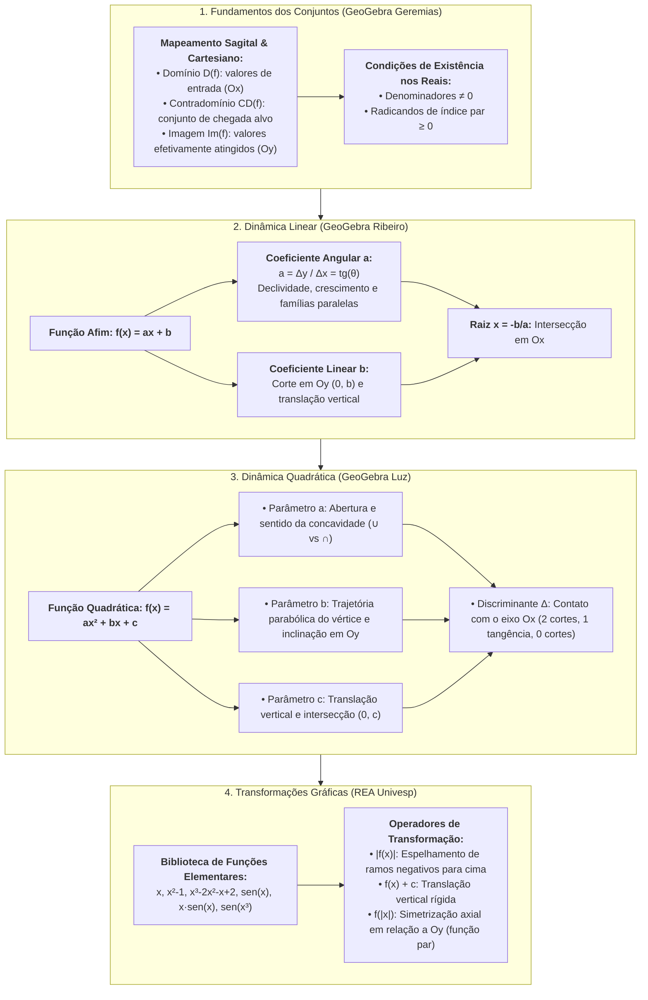
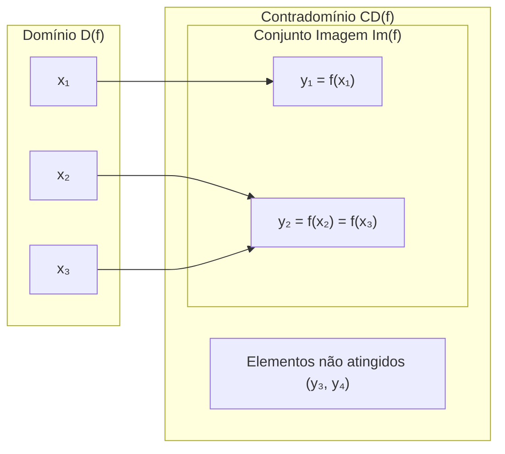
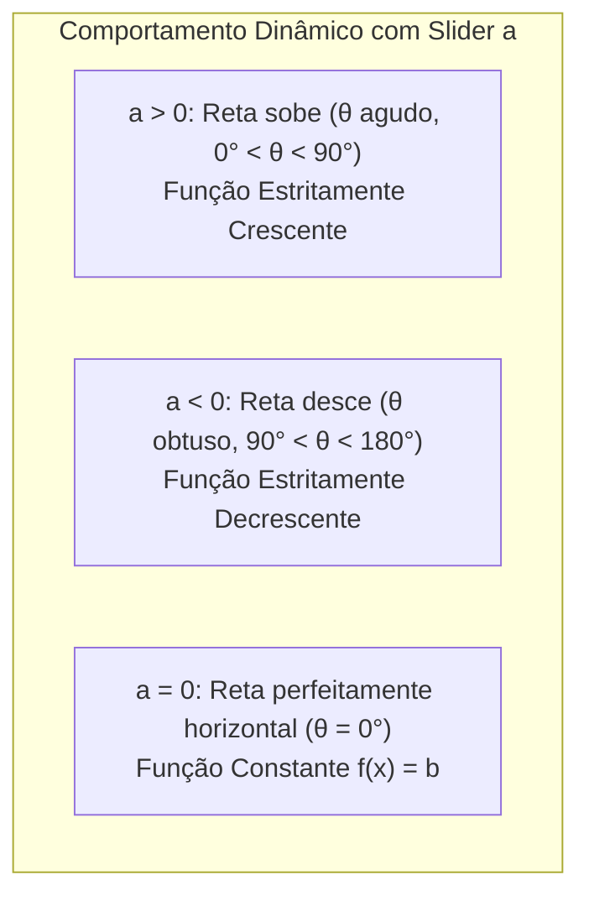
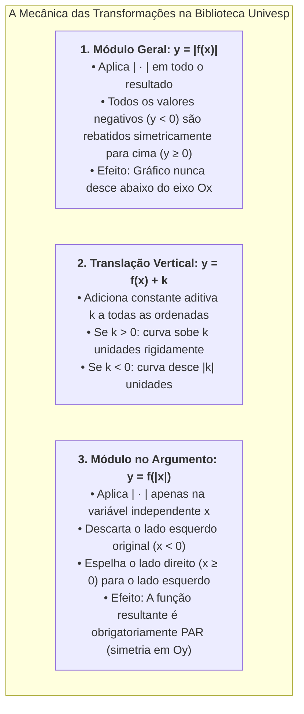

# 🔬 Aprofundando o Tema — Semana 6 (MMB002)
### Exploração Paramétrica, Álgebra Visual e Biblioteca Interativa de Funções

> **Disciplina:** Matemática Básica (`MMB002-EC-2026S2B2-T001`)  
> **Tema da Semana 6:** Funções: Conceitos, Representações e Modelagem (1º e 2º Grau)  
> **Docente Responsável:** Profª Dra. Rúbia Barcelos Amaral  
> **Composição do Material:**  
> 1. 🧮 **GeoGebra 1:** *Domínio, contradomínio e imagem de uma função* | Isabela Pereira Geremias  
> 2. 🧮 **GeoGebra 2:** *Função do 1º grau* | Felipe Ribeiro  
> 3. 🧮 **GeoGebra 3:** *Função do 2º grau: entendendo os seus coeficientes* | Valéria Moura da Luz  
> 4. 🌐 **Software REA Univesp:** *Biblioteca de funções e transformações gráficas* | Univesp  
> **Status:** 🟢 **Síntese Teórica, Algorítmica e Interativa Concluída**

---

## 🗺️ Mapa Conceitual Integrado de Aprofundamento

---

## 🧮 1. GeoGebra: Domínio, Contradomínio e Imagem de uma Função (Isabela Geremias)

* **Autoria:** Isabela Pereira Geremias  
* **Plataforma:** GeoGebra  
* **Link Interativo:** [geogebra.org/m/m3pqxdyj](https://www.geogebra.org/m/m3pqxdyj)  
* **Foco Pedagógico:** Visualização dinâmica da relação entre os conjuntos $A$ (partida) e $B$ (chegada), compreensão da condição de unicidade e identificação clara da diferença entre Contradomínio e Conjunto Imagem.

---

### 1.1. O Mapeamento Funcional em Duas Linguagens
O applet permite ao estudante comparar simultaneamente a representação por **Diagramas de Venn (diagramas de flechas)** e a representação no **Plano Cartesiano $\mathbb{R}^2$**:

1. **Linguagem dos Diagramas de Venn:**
   * O conjunto de partida $A$ é o **Domínio $D(f)$**. Todo elemento $x \in A$ deve disparar uma, e somente uma, flecha.
   * O conjunto de chegada $B$ é o **Contradomínio $CD(f)$**.
   * Os elementos de $B$ que recebem pelo menos uma flecha formam o **Conjunto Imagem $\text{Im}(f)$**.
   $$\text{Im}(f) \subseteq CD(f)$$

2. **Linguagem Cartesiana por Projeções Ortogonais:**
   * **Domínio:** "Sombra" horizontal da curva sobre o eixo das abscissas ($Ox$).
   * **Imagem:** "Sombra" vertical da curva sobre o eixo das ordenadas ($Oy$).

---

### 1.2. Condições de Existência nos Números Reais (Domínio de Validade)
Ao trabalhar com funções reais de variável real ($f: D \subseteq \mathbb{R} \to \mathbb{R}$), o applet reforça as duas grandes restrições aritméticas fundamentais que limitam o domínio:

| Restrição Algébrica | Condição Matemática de Existência | Exemplo Típico | Domínio Resultante |
| :--- | :---: | :--- | :---: |
| **Denominador Fracionário** | O denominador não pode ser nulo ($D \neq 0$) | $f(x) = \frac{5}{x - 3}$ | $D(f) = \mathbb{R} \setminus \{3\}$ |
| **Radicando de Índice Par** | O radicando deve ser não negativo ($R \geq 0$) | $f(x) = \sqrt{2x - 8}$ | $2x - 8 \geq 0 \implies D(f) = [4, +\infty[$ |
| **Combinação (Raiz no Denominador)** | O radicando deve ser estritamente positivo ($R > 0$) | $f(x) = \frac{1}{\sqrt{x + 2}}$ | $x + 2 > 0 \implies D(f) = ]-2, +\infty[$ |

---

## 🧮 2. GeoGebra: Função do 1º Grau (Felipe Ribeiro)

* **Autoria:** Felipe Ribeiro  
* **Plataforma:** GeoGebra  
* **Link Interativo:** [geogebra.org/m/dpfqaDZn](https://www.geogebra.org/m/dpfqaDZn)  
* **Foco Pedagógico:** Manipulação interativa da inclinação ($a$) e da altura inicial ($b$) da reta afim $f(x) = ax + b$, visualizando o triângulo retângulo da taxa média e a determinação geométrica da raiz.

---

### 2.1. O Triângulo de Variação e o Coeficiente Angular ($a$)
O recurso destaca dinamicamente o triângulo retângulo formado entre dois pontos quaisquer da reta $P_1(x_1, y_1)$ e $P_2(x_2, y_2)$:
* **Cateto Adjacente Horizontal:** $\Delta x = x_2 - x_1$
* **Cateto Oposto Vertical:** $\Delta y = y_2 - y_1 = f(x_2) - f(x_1)$
* **Razão Constante (Declividade):**
  $$a = \frac{\Delta y}{\Delta x} = \tan \theta$$

### 2.2. Famílias de Retas na Experimentação:
1. **Retas Paralelas:** Mantendo o controle deslizante $a$ fixo e variando apenas $b$, a reta translada verticalmente sem alterar seu ângulo de inclinação (todas as retas possuem a mesma declividade $a$).
2. **Feixe de Retas Concorrentes:** Mantendo $b$ fixo e variando $a$, a reta rotaciona em torno do ponto fixo de corte com o eixo das ordenadas $(0, b)$.
3. **Deslocamento da Raiz:** Conforme o aluno altera $b$ ou $a$, o ponto de corte no eixo horizontal desliza de acordo com a razão $x = -\frac{b}{a}$.

---

## 🧮 3. GeoGebra: Função do 2º Grau — Entendendo os seus Coeficientes (Valéria Moura da Luz)

* **Autoria:** Valéria Moura da Luz  
* **Plataforma:** GeoGebra  
* **Link Interativo:** [geogebra.org/m/rtfzgdc7](https://www.geogebra.org/m/rtfzgdc7)  
* **Foco Pedagógico:** Isolamento e investigação minuciosa de cada um dos parâmetros da parábola quadrática $f(x) = ax^2 + bx + c$, desvendando a física geométrica por trás de cada termo algébrico.

---

### 3.1. Efeitos Individuais dos Coeficientes

#### 🔹 Coeficiente $a$ (Curvatura e Concavidade)
* **Direção:** $a > 0 \implies$ concavidade para cima ($\cup$); $a < 0 \implies$ concavidade para baixo ($\cap$).
* **Taxa de Curvatura:** À medida que $|a|$ aumenta, a parábola se torna mais pontiaguda e seus ramos se fecham rapidamente. Quando $|a|$ aproxima-se de zero, a parábola se achata progressivamente até que, em $a = 0$, perde o segundo grau e degenera na reta $y = bx + c$.

#### 🔹 Coeficiente $b$ (Inclinação na Origem e Trajetória do Vértice)
* **Significado na Intersecção com $Oy$:** O coeficiente $b$ mede a declividade da reta tangente à parábola no ponto de corte $(0, c)$:
  * $b > 0$: A parábola cruza o eixo $y$ em fase **crescente** (subindo).
  * $b < 0$: A parábola cruza o eixo $y$ em fase **decrescente** (descendo).
  * $b = 0$: A parábola cruza o eixo $y$ exatamente em seu **vértice** (o eixo $y$ é o eixo de simetria).
* **Lugar Geométrico do Vértice:** Ao fixar $a$ e $c$ e variar apenas $b$, o vértice $V(x_v, y_v)$ não se move aleatoriamente: ele descreve com exatidão uma **outra parábola invertida** de equação $y = -ax^2 + c$.

#### 🔹 Coeficiente $c$ (Termo Independente e Translação Vertical)
* O coeficiente $c$ representa o ponto exato onde a curva encontra o eixo vertical: $(0, c)$.
* A alteração de $c$ produz uma **translação vertical pura**: o gráfico sobe ou desce no plano sem alterar em absolutamente nada sua curvatura ou largura.

---

### 3.2. A Dinâmica do Discriminante ($\Delta$) com a Elevação da Curva
Ao fixar $a > 0$ e manipular o controle de $c$:
* **$c$ baixo ($\Delta = b^2 - 4ac > 0$):** A curva mergulha abaixo do eixo horizontal, cortando-o em dois pontos distintos $(x_1, 0)$ e $(x_2, 0)$.
* **$c = \frac{b^2}{4a}$ ($\Delta = 0$):** O vértice encosta exatamente sobre o eixo $Ox$, havendo uma única raiz real dupla.
* **$c$ alto ($\Delta < 0$):** A curva se descola completamente do eixo $Ox$, ficando suspensa no semiplano superior sem raízes reais.

---

## 🌐 4. Software REA Univesp: Biblioteca de Funções e Transformações Gráficas

* **Desenvolvimento:** Univesp (Recurso Educacional Aberto)  
* **Link Oficial:** [apps.univesp.br/biblioteca-de-funcoes/](https://apps.univesp.br/biblioteca-de-funcoes/)  
* **Repositório de Código Aberto:** [github.com/univesp/biblioteca-de-funcoes](https://github.com/univesp/biblioteca-de-funcoes/)  
* **Foco Pedagógico:** Laboratório virtual que submete gráficos fundamentais a operadores de transformação analítica (modularização e translações), permitindo antecipar o comportamento visual de funções complexas no cálculo.

---

### 4.1. As Funções de Referência da Biblioteca

A aplicação reúne as principais famílias de funções que fundamentam a formação em engenharia e ciências exatas:
1. **$f(x) = x$:** A função identidade linear (bissetriz do 1º e 3º quadrantes).
2. **$f(x) = x^2 - 1$:** A parábola quadrática com raízes em $x = \pm 1$ e vértice em $(0, -1)$.
3. **$f(x) = x^3 - 2x^2 - x + 2$:** A função polinomial cúbica de 3º grau com pontos de inflexão e três raízes reais.
4. **$f(x) = \sin(x)$:** A onda senoidal periódica oscilando no intervalo $[-1, 1]$.
5. **$f(x) = x \cdot \sin(x)$:** Onda com envelope de modulação linear de amplitude (cresce oscilando).
6. **$f(x) = \sin(x^3)$:** Onda com modulação cúbica de frequência (oscilações progressivamente mais rápidas).

---

### 4.2. Os Três Operadores de Transformação Gráfica

#### Estudo de Caso 1: A Transformação Modular em $f(x) = x^2 - 1$
* **Original:** Parábola com vértice em $(0, -1)$ e raízes em $x = -1$ e $x = 1$. O trecho entre $-1 < x < 1$ situa-se abaixo do eixo $x$.
* **Ao aplicar $|f(x)| = |x^2 - 1|$:**
  * Para $x \leq -1$ ou $x \geq 1$, a função já era positiva e permanece idêntica.
  * Para o intervalo $[-1, 1]$, os valores negativos são multiplicados por $-1$. O vértice $(0, -1)$ é rebatido para cima, tornando-se o pico $(0, 1)$ com dois "bicos" angulosos nas raízes $(-1, 0)$ e $(1, 0)$ (pontos não diferenciáveis no cálculo).

#### Estudo de Caso 2: A Simetrização Par em $f(|x|)$
* Como $|-x| = |x|$, temos $f(|-x|) = f(|x|)$ para todo $x$.  
* Isso garante que qualquer função submetida a essa operação torna-se **simétrica em relação ao eixo das ordenadas ($Oy$)**, característica das funções pares.

---

# 📊 Matriz Comparativa dos Recursos de Aprofundamento

| Recurso | Plataforma | Tipo de Interação | Conceito-Chave Exploratório | Aplicação Primária |
| :--- | :---: | :---: | :--- | :--- |
| **Domínio, Contradomínio e Imagem** | GeoGebra | Diagrama de flechas e projeções | Correspondência unívoca, restrições reais de existência ($D \neq 0, R \geq 0$). | Fundamentação conceitual e validação de existência de funções. |
| **Função do 1º Grau** | GeoGebra | Sliders contínuos de $a$ e $b$ | Taxa constante $\Delta y / \Delta x$, ângulo $\theta$, paralelismo e raízes. | Modelagem linear de custos, velocidades e projeções de retas. |
| **Função do 2º Grau: Coeficientes** | GeoGebra | Sliders de $a, b, c$ com rastros | Papel dinâmico dos parâmetros, trajetória do vértice e translação pura. | Otimização de processos, balística e estruturas em arco/parábola. |
| **Biblioteca de Funções** | REA Univesp | Botões de operadores analíticos | Transformações gráficas: modularização $|f(x)|$, translação $f(x)+k$ e paridade $f(|x|)$. | Interpretação avançada de curvas e preparação direta para o Cálculo Diferencial. |
