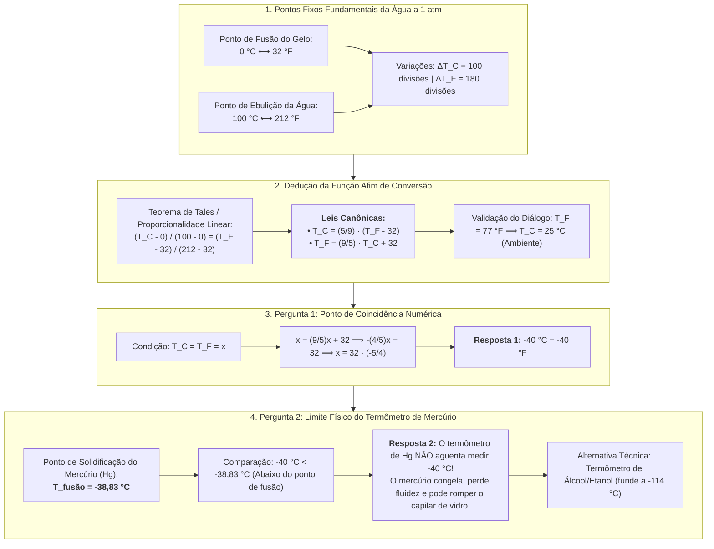

# 💬 Fórum Temático — Semana 6 (MMB002)
### O Desafio de Bia: Relações Lineares entre Escalas Termométricas e os Limites Físicos do Mercúrio

> **Disciplina:** Matemática Básica (`MMB002-EC-2026S2B2-T001`)  
> **Tema da Semana 6:** Funções: Conceitos, Representações e Modelagem (Funções do 1º Grau)  
> **Docente Responsável:** Profª Dra. Rúbia Barcelos Amaral  
> **Período de Participação:** 02/11/2026 a 15/11/2026  
> **Áudio Oficial do Desafio:** [`s6_audio_desafio.mp3`](https://assets.univesp.br/disciplinas/MMB002/audios/s6_audio_desafio.mp3) (Coleção *M³ Matemática Multimídia* — IMECC / Unicamp)  
> **Status:** 🟢 **Resolução Analítica, Física e Modelos Prontos para Postagem no AVA**  

---

## 📌 Enunciado Oficial & Transcrição Integral do Áudio

> **Transcrição Oficial do Áudio (M³ Matemática Multimídia — Série Problemas e Soluções):**
>
> *(Locução de abertura: "Este programa faz parte da série problemas e soluções da coleção M3 Matemática Multimídia e trata de um problema associado a escalas de temperatura. M3 Matemática Multimídia apresenta: Série Problemas e Soluções.")*
>
> — **Enfermeira Marina:** *Oi, Bia, tudo bom?*  
> — **Bia:** *Oi, enfermeira Marina, tudo bom. E você?*  
> — **Marina:** *Tudo bem! Então, eu preciso que você guarde esse lote de vacinas no refrigerador, por favor.*  
> — **Bia:** *Ai, Marina, não tem espaço no refrigerador, preciso ver com a supervisora de manutenção onde podemos colocar essas vacinas. Vou chamá-la.*  
> — **Supervisora Cíntia:** *Boa tarde, enfermeira Marina, você me chamou?*  
> — **Marina:** *Chamei, sim, supervisora Cíntia. Eu preciso que esse lote de vacina seja armazenado em um refrigerador.*  
> — **Cíntia:** *Bom, o nosso refrigerador principal está lotado. Mas temos um freezer doado há algum tempo que pode ser usado para guardar as suas vacinas. Acompanhe-me, por favor. Bia, venha também.*  
> — **Bia:** *Dona Cíntia, eu acho melhor resfriar o interior do freezer primeiro.*  
> — **Cíntia:** *Por quê?*  
> — **Bia:** *Porque aqui no termômetro diz que o interior do freezer está com 77°.*  
> — **Cíntia:** *Não, impossível. Isso é um freezer, não um forno. Sem falar que estamos na temperatura ambiente, esse termômetro deve estar quebrado. Deixa eu dar uma olhadinha... Nossa, e agora? Se essas vacinas não forem conservadas corretamente, elas vão estragar.*  
> — **Cíntia:** *Não se preocupe, enfermeira Marina, eu já identifiquei o problema. É que esse freezer veio dos Estados Unidos, então a escala termométrica dele é em Fahrenheit. Sendo assim, eu creio que a temperatura no interior do freezer esteja normal.*  
> — **Bia:** *Sim, eu lembro que 77° em Fahrenheit correspondem a 25 °C. Lembro isso das minhas aulas de física.*  
> — **Cíntia:** *Sim, Bia, a conversão entre as duas escalas é uma função.*  
> — **Marina:** *Nossa, mas é tão discrepante assim a diferença entre as duas escalas? Não existe um valor em que as duas escalas apresentam a mesma temperatura?*  
> — **Cíntia:** *Existe, sim. Você sabe, não é, Bia?*  
> — **Bia:** *Eu? Por que eu?*  
> — **Cíntia:** *Porque você estuda isso no colegial. Enquanto a enfermeira Marina vai ajeitando as vacinas, eu quero que você calcule e me fale a resposta quando ela terminar de guardar as vacinas, tá bom?*  
> — **Bia:** *Mas Dona Cíntia, eu não sei as fórmulas de conversão entre Celsius e Fahrenheit.*  
> — **Cíntia:** *Procura na internet que você deve achar, sim. Além disso, me fala também se o termômetro de Mercúrio que a gente usa aguentaria medir a temperatura que você achar na resposta.*  
> — **Bia:** *Entendi, Dona Cíntia. Estou vendo que meu tempo livre desta tarde será para resolver esse quebra-cabeça.*  
> — **Cíntia:** *Então, enfermeira Marina, eu acho que o freezer já está numa temperatura adequada para as suas vacinas. A Bia vai ficar à sua disposição para qualquer ajuda. Daqui a pouquinho eu volto para cobrar as respostas de você, viu, Bia?*  
> — **Marina:** *Obrigada, supervisora Cíntia.*  
> — **Bia:** *Ai, que medo eu tenho da Dona Cíntia...*  
>
> **Comando do Fórum:** *Compartilhe no Fórum Temático dessa semana como resolver o problema de Bia.*

---

## 🗺️ Mapa Conceitual da Modelagem do Problema de Bia

---

## 🧮 Resolução Analítica Passo a Passo

### 1. Dedução Formal da Função Linear de Conversão
Como as duas escalas medem a mesma grandeza física (energia térmica média das moléculas) por dilatação volumétrica linear de líquidos, a relação entre elas é uma **função polinomial de 1º grau (função afim)**:

$$T_F = a \cdot T_C + b$$

Utilizando os pontos fixos da água à pressão normal de $1\text{ atm}$:
* Ponto de fusão do gelo: $(T_C, T_F) = (0, 32)$
* Ponto de ebulição da água: $(T_C, T_F) = (100, 212)$

Aplicando a proporção linear do Teorema de Tales:
$$\frac{T_C - 0}{100 - 0} = \frac{T_F - 32}{212 - 32} \implies \frac{T_C}{100} = \frac{T_F - 32}{180}$$

Simplificando dividindo ambos os denominadores por $20$:
$$\frac{T_C}{5} = \frac{T_F - 32}{9}$$

Isolando as variáveis:
$$T_C(T_F) = \frac{5}{9}(T_F - 32) \quad \text{e} \quad T_F(T_C) = \frac{9}{5}T_C + 32$$

---

### 2. Validação da Cena Inicial: O Freezer em 77 °F
Ao verificar a temperatura indicada no visor do freezer:
$$T_C = \frac{5}{9}(77 - 32) = \frac{5}{9}(45) = 5 \times 5 = \mathbf{25^\circ\text{C}}$$
*Isso confirma a intuição de Bia e Cíntia: o freezer recém-ligado estava em temperatura ambiente ($25^\circ\text{C}$), precisando de tempo para resfriar até a faixa segura de vacinas ($+2^\circ\text{C}$ a $+8^\circ\text{C}$).*

---

### 3. Resolução da Pergunta 1: O Ponto de Coincidência Numérica
> *Existe algum valor em que as duas escalas apresentam a mesma indicação numérica?*

Impõe-se a condição de igualdade $T_C = T_F = x$:
$$x = \frac{9}{5}x + 32$$
$$x - \frac{9}{5}x = 32$$
$$\frac{5x - 9x}{5} = 32 \implies -\frac{4x}{5} = 32$$
$$-4x = 160 \implies x = \frac{160}{-4} = \mathbf{-40}$$

#### ✅ Prova Real:
* Em Fahrenheit: $T_F(-40) = \frac{9}{5}(-40) + 32 = 9(-8) + 32 = -72 + 32 = \mathbf{-40^\circ\text{F}}$
* Em Celsius: $T_C(-40) = \frac{5}{9}(-40 - 32) = \frac{5}{9}(-72) = 5(-8) = \mathbf{-40^\circ\text{C}}$

$$\mathbf{-40^\circ\text{C} \equiv -40^\circ\text{F}}$$

---

### 4. Resolução da Pergunta 2: O Termômetro de Mercúrio Aguenta Medir $-40^\circ\text{C}$?
> *O termômetro de mercúrio que a gente usa aguentaria medir a temperatura que você achar na resposta?*

* **Propriedade Físico-Química do Mercúrio ($\text{Hg}$):**  
  O mercúrio é o único metal líquido em condições normais de temperatura e pressão, mas possui ponto de solidificação (ponto de fusão) bem delimitado:
  $$T_{\text{fusão}}(\text{Hg}) = \mathbf{-38{,}83^\circ\text{C}} \quad (\approx -39^\circ\text{C})$$
* **Análise Termodinâmica:**  
  A temperatura encontrada é de **$-40^\circ\text{C}$**, que é estritamente **menor** que o ponto de congelamento do mercúrio:
  $$-40^\circ\text{C} < -38{,}83^\circ\text{C}$$
* **Conclusão Técnica:**  
  * O termômetro de mercúrio **NÃO aguentaria medir** $-40^\circ\text{C}$.  
  * Ao atingir $-38{,}83^\circ\text{C}$, o mercúrio sofre transição de fase de líquido para **sólido cristalino**. Ao congelar, a coluna metálica perde a capacidade de fluir e dilatar-se linearmente pelo tubo capilar.  
  * Além disso, a contração volumétrica e a mudança de fase podem gerar tensões mecânicas capazes de fraturar o bulbo de vidro.
* **Alternativa Tecnológica Adequada:**  
  Para medições criogênicas ou em temperaturas de $-40^\circ\text{C}$, utilizam-se:
  1. **Termômetros de Álcool Líquido (Etanol colorido):** O etanol possui ponto de fusão em **$-114^\circ\text{C}$**, operando perfeitamente a $-40^\circ\text{C}$.
  2. **Sensores Eletrônicos (Termopares tipo T ou PT100 / Termistores NTC):** Dispositivos digitais com faixa operacional que atinge até $-200^\circ\text{C}$, ideais para controle de cadeia de frio de imunobiológicos.

---

## 📝 Modelos de Resposta Prontos para Postagem no Fórum

Abaixo estão disponibilizados três modelos de redação com diferentes estilos para você escolher e postar no Fórum Temático da Univesp:

---

### 🌟 Opção 1: Modelo Completo, Formal e Fundamentado (Recomendado para Destaque)

> **Título:** Resolução do Desafio de Bia: A Função Afim das Escalas Termométricas e o Limite Físico do Mercúrio
>
> Olá, professora Rúbia, tutores e colegas!
>
> Ao analisar a instigante situação-problema vivenciada por Bia, pela enfermeira Marina e pela supervisora Cíntia no áudio da coleção *M³ Matemática Multimídia*, podemos estruturar a solução a partir dos conceitos de funções polinomiais do 1º grau (funções afins) e propriedades termodinâmicas dos materiais.
>
> ---
>
> ### 1. A Modelagem Linear da Conversão de Temperatura
> As escalas Celsius ($T_C$) e Fahrenheit ($T_F$) correlacionam-se linearmente a partir dos pontos de transição de fase da água sob pressão de $1\text{ atm}$:
> * Ponto de fusão do gelo: $0^\circ\text{C} \longleftrightarrow 32^\circ\text{F}$
> * Ponto de ebulição da água: $100^\circ\text{C} \longleftrightarrow 212^\circ\text{F}$
>
> Pela proporcionalidade dos segmentos nos termômetros:
> $$\frac{T_C - 0}{100 - 0} = \frac{T_F - 32}{212 - 32} \implies \frac{T_C}{5} = \frac{T_F - 32}{9}$$
>
> Obtemos a lei da função afim:
> $$T_F(T_C) = \frac{9}{5}T_C + 32 \quad \text{ou} \quad T_C(T_F) = \frac{5}{9}(T_F - 32)$$
>
> *(Nota: Isso valida a observação de Bia no diálogo: para $T_F = 77^\circ\text{F}$, temos $T_C = \frac{5}{9}(77 - 32) = 25^\circ\text{C}$, que é a temperatura ambiente do local).*
>
> ---
>
> ### 2. Pergunta 1: O Ponto de Coincidência Numérica ($T_C = T_F$)
> Para responder à primeira indagação da supervisora Cíntia, buscamos o ponto fixo onde a indicação numérica é idêntica em ambas as escalas ($T_C = T_F = x$):
>
> $$x = \frac{9}{5}x + 32$$
> $$x - \frac{9}{5}x = 32 \implies -\frac{4}{5}x = 32 \implies x = 32 \times \left(-\frac{5}{4}\right) = \mathbf{-40}$$
>
> **Resposta 1:** O único valor em que ambas as escalas registram rigorosamente o mesmo número é **$-40^\circ$**, ou seja:
> $$\mathbf{-40^\circ\text{C} \equiv -40^\circ\text{F}}$$
>
> ---
>
> ### 3. Pergunta 2: O Termômetro de Mercúrio Aguentaria Medir essa Temperatura?
> Na segunda questão, entra em cena a física e a ciência dos materiais.
>
> * O ponto de congelamento (solidificação) do mercúrio metálico ($\text{Hg}$) à pressão atmosférica é de **$-38{,}83^\circ\text{C}$** (aproximadamente $-39^\circ\text{C}$).
> * Como a temperatura encontrada é de **$-40^\circ\text{C}$**, ela é **inferior** ao ponto de fusão do mercúrio ($-40^\circ\text{C} < -38{,}83^\circ\text{C}$).
>
> **Resposta 2:** Portanto, o termômetro clínico de mercúrio **NÃO aguentaria medir essa temperatura**. Ao atingir $-38{,}83^\circ\text{C}$, o mercúrio congela e passa para o estado sólido, perdendo a fluidez necessária para subir ou descer no capilar de vidro e podendo causar a quebra do bulbo devido à variação volumétrica anômala.
>
> **Solução Técnica Recomendada:** Em ambientes de armazenamento criogênico ou freezers ultra-frios (como os utilizados para certas vacinas e materiais biológicos a $-40^\circ\text{C}$ ou $-70^\circ\text{C}$), deve-se empregar:
> 1. **Termômetros de Álcool (Etanol):** cujo ponto de solidificação é de **$-114^\circ\text{C}$**;
> 2. **Sensores Digitais (Termopares ou Termorresistências PT100):** que realizam leitura eletrônica estável mesmo em temperaturas extremamente baixas.
>
> Um excelente exemplo de como a modelagem por funções do 1º grau conecta a matemática pura à segurança na área da saúde!
>
> Um abraço a todos e bons estudos!

---

### ⚡ Opção 2: Modelo Direto, Claro e Objetivo

> **Título:** Resolução do Desafio das Escalas de Temperatura (Semana 6)
>
> Olá a todos!
>
> Segue a minha contribuição para ajudar a Bia a responder às duas perguntas da supervisora Cíntia:
>
> **1. Em qual temperatura as escalas Celsius e Fahrenheit marcam o mesmo número?**  
> A conversão entre Celsius ($C$) e Fahrenheit ($F$) é dada pela função de 1º grau:
> $$C = \frac{5}{9}(F - 32)$$
> Fazendo $C = F = x$:
> $$x = \frac{5}{9}(x - 32) \implies 9x = 5x - 160 \implies 4x = -160 \implies x = \mathbf{-40}$$
> Portanto, as duas escalas coincidem exatamente em **$-40^\circ$** (isto é, $-40^\circ\text{C} = -40^\circ\text{F}$).
>
> **2. O termômetro de mercúrio aguenta medir essa temperatura?**  
> **Não.** O mercúrio tem ponto de congelamento (solidificação) em aproximadamente **$-38{,}8^\circ\text{C}$**. Como $-40^\circ\text{C}$ é mais frio que esse ponto, o mercúrio estaria congelado (sólido), impedindo a leitura e correndo o risco de danificar o termômetro.
>
> Para essa temperatura, o correto seria usar um termômetro de álcool (que congela a $-114^\circ\text{C}$) ou um termômetro digital com sensor termopar.
>
> Abraços!

---

### 🏥 Opção 3: Modelo Focado em Aplicação Prática e Gestão Hospitalar

> **Título:** Aplicação da Função Afim na Conservação de Vacinas: O Desafio de Bia
>
> Boa tarde, colegas e tutores!
>
> A situação narrada no áudio ilustra com clareza a importância da matemática básica e da metrologia na rotina de uma unidade de saúde.
>
> **1. A Função de Conversão e a Coincidência:**  
> A relação entre Fahrenheit e Celsius é expressa pela função afim $T_F = 1{,}8 \cdot T_C + 32$.  
> No diálogo, o termômetro em $77^\circ\text{F}$ indicava $25^\circ\text{C}$ (temperatura ambiente).  
> Para encontrar a coincidência ($T_C = T_F = x$):
> $$x = 1{,}8x + 32 \implies -0{,}8x = 32 \implies x = \frac{32}{-0{,}8} = \mathbf{-40^\circ}$$
> Assim, $-40^\circ\text{C}$ equivale a $-40^\circ\text{F}$.
>
> **2. Limitação do Termômetro de Mercúrio na Rede de Frio:**  
> O mercúrio se solidifica a **$-38{,}83^\circ\text{C}$**. Logo, a $-40^\circ\text{C}$ o instrumento se torna inoperante porque o metal no interior do capilar se congela. Na prática hospitalar e laboratorial, para faixas criogênicas ou de congelamento profundo, a Anvisa e manuais de biossegurança recomendam termômetros de expansão alcoólica (etanol colorido) ou registradores eletrônicos de dados (*data loggers* com sensor PT100), garantindo a confiabilidade no armazenamento dos imunobiológicos.
>
> Abraços e ótima semana de aprendizado!
