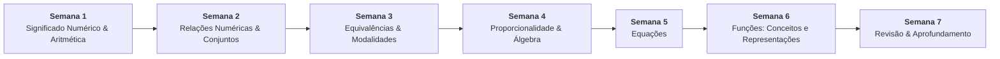

# 📚 Semana 6 — Funções: Conceitos e Representações

> **Disciplina:** Matemática Básica (`MMB002-EC-2026S2B2-T001`)  
> **Curso:** Bacharelado em Engenharia de Computação — Univesp  
> **Docente Responsável:** Profª Dra. Rúbia Barcelos Amaral  
> **Período:** 02/11/2026 a 15/11/2026  
> **Status:** 🟢 **Concluído (10,0 / 10,0)**  

---

## 📁 Estrutura de Arquivos da Semana 6

| Arquivo | Descrição | Status |
| :--- | :--- | :---: |
| [**`0-Inicio.md`**](file:///home/henrique/Modelos/Univesp/2026S2B2/MMB002-Matematica-Basica/Semana-6/0-Inicio.md) | Contextualização oficial, objetivos pedagógicos, transcrição do áudio e resolução pioneira do Desafio de Bia | 🟢 Pronto |
| [**`1-Videoaulas.md`**](file:///home/henrique/Modelos/Univesp/2026S2B2/MMB002-Matematica-Basica/Semana-6/1-Videoaulas.md) | Síntese integrada das Videoaulas 17 (Prof. Francisco) e 18 (Prof. Cláudio Possani) com análise de slides | 🟢 Pronto |
| [**`2.1-Texto-base-Manual-Compacto-Funcoes.md`**](file:///home/henrique/Modelos/Univesp/2026S2B2/MMB002-Matematica-Basica/Semana-6/2.1-Texto-base-Manual-Compacto-Funcoes.md) | Síntese do Cap. 15 de *Manual Compacto de Matemática* (Bosquilha et al., p. 297–321): conceitos, afim e quadrática | 🟢 Pronto |
| [**`2.2-Texto-base-Fundamentos-de-Matematica-Araujo.md`**](file:///home/henrique/Modelos/Univesp/2026S2B2/MMB002-Matematica-Basica/Semana-6/2.2-Texto-base-Fundamentos-de-Matematica-Araujo.md) | Síntese de *Fundamentos de Matemática* (Araújo et al., p. 55–82): modelagem afim, break-even e otimização quadrática | 🟢 Pronto |
| [**`3-Material-base.md`**](file:///home/henrique/Modelos/Univesp/2026S2B2/MMB002-Matematica-Basica/Semana-6/3-Material-base.md) | Síntese das videoaulas de apoio (Sandro Curió, Thor Franzen no GeoGebra e Prof. Daniel Ferretto) | 🟢 Pronto |
| [**`4-Atividade-avaliativa.md`**](file:///home/henrique/Modelos/Univesp/2026S2B2/MMB002-Matematica-Basica/Semana-6/4-Atividade-avaliativa.md) | Resolução analítica passo a passo de todas as 8 questões avaliativas com validação e **gabarito oficial (10,0 / 10,0)** | 🟢 Pronto |
| [**`5-Aprofundando-o-tema.md`**](file:///home/henrique/Modelos/Univesp/2026S2B2/MMB002-Matematica-Basica/Semana-6/5-Aprofundando-o-tema.md) | Explorações interativas no GeoGebra (Geremias, Ribeiro, Luz) e Recurso Educacional Aberto da Univesp | 🟢 Pronto |
| [**`6-Forum-tematico.md`**](file:///home/henrique/Modelos/Univesp/2026S2B2/MMB002-Matematica-Basica/Semana-6/6-Forum-tematico.md) | Modelagem da escala linear de temperatura, física termométrica do mercúrio e respostas formatadas para o AVA | 🟢 Pronto |
| [**`7-Em-sintese.md`**](file:///home/henrique/Modelos/Univesp/2026S2B2/MMB002-Matematica-Basica/Semana-6/7-Em-sintese.md) | Resumo executivo, mapa mental em Mermaid, matriz comparativa 1º vs 2º grau e checklist de competências | 🟢 Pronto |
| [**`desafio_escalas_s6.cpp`**](file:///home/henrique/Modelos/Univesp/2026S2B2/MMB002-Matematica-Basica/Semana-6/desafio_escalas_s6.cpp) | Validador computacional em C++ do ponto fixo $-40^\circ\text{C} = -40^\circ\text{F}$ e limite de solidificação do mercúrio | 🟢 Pronto |
| [**`resolucao_questoes_s6.cpp`**](file:///home/henrique/Modelos/Univesp/2026S2B2/MMB002-Matematica-Basica/Semana-6/resolucao_questoes_s6.cpp) | Validador computacional em C++ das 8 questões avaliativas com conferência exata dos cálculos algébricos | 🟢 Pronto |
| [**`s6_slides_videoaula17-introducao_as_funcoes.pdf`**](file:///home/henrique/Modelos/Univesp/2026S2B2/MMB002-Matematica-Basica/Semana-6/s6_slides_videoaula17-introducao_as_funcoes.pdf) | Slides oficiais da Videoaula 17 (Prof. Francisco) | 📑 Arquivado |
| [**`s6_slides_videoaula18-funcao_polinomial_do_1_grau.pdf`**](file:///home/henrique/Modelos/Univesp/2026S2B2/MMB002-Matematica-Basica/Semana-6/s6_slides_videoaula18-funcao_polinomial_do_1_grau.pdf) | Slides oficiais da Videoaula 18 (Prof. Cláudio Possani) | 📑 Arquivado |

---

## 🧭 Relação com as Demais Semanas

