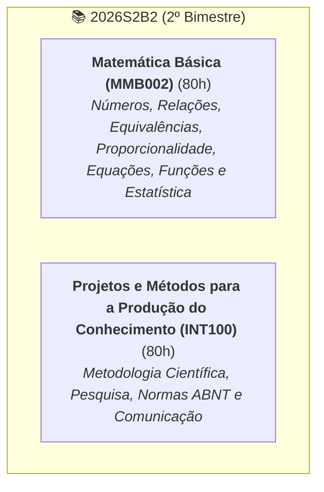

# 📊 Status Geral de Estudos — 2026S2B2 (Univesp)

> **Bimestre:** 2º Semestre de 2026 — 2º Bimestre (Bimestre Par)  
> **Curso:** Bacharelado em Engenharia de Computação (Univesp)  
> **Última Atualização:** 10 de outubro de 2026  

---

## 🗺️ Visão Geral das Disciplinas do Bimestre 2

---

## 📌 Disciplinas e Estrutura de Pastas

* [ ] [`INT100-Projetos-e-Metodos-para-a-Producao-do-Conhecimento/`](file:///home/henrique/Modelos/Univesp/2026S2B2/INT100-Projetos-e-Metodos-para-a-Producao-do-Conhecimento/): **80h** (10h/semana) — *Metodologia Científica, Pesquisa, Normas e Comunicação Acadêmica* (Profª Dra. Graziella R. S. Moura).
  * Critério de Avaliação: $MF = 0,6 \times N_1 + 0,4 \times N_2$
  * [**Semana 1** (28/09)](file:///home/henrique/Modelos/Univesp/2026S2B2/INT100-Projetos-e-Metodos-para-a-Producao-do-Conhecimento/Semana-1): Senso comum e ciência — **CONCLUÍDO (10,0 / 10,0)** 🟢
  * [**Semana 2** (05/10)](file:///home/henrique/Modelos/Univesp/2026S2B2/INT100-Projetos-e-Metodos-para-a-Producao-do-Conhecimento/Semana-2): Fundamentos da metodologia científica e técnicas de pesquisa — **CONCLUÍDO (10,0 / 10,0)** 🟢
  * [**Semana 3** (12/10)](file:///home/henrique/Modelos/Univesp/2026S2B2/INT100-Projetos-e-Metodos-para-a-Producao-do-Conhecimento/Semana-3): Comunicação científica: rigor e ética em pesquisa — **CONCLUÍDO (10,0 / 10,0)** 🟢
  * [**Semana 4** (19/10)](file:///home/henrique/Modelos/Univesp/2026S2B2/INT100-Projetos-e-Metodos-para-a-Producao-do-Conhecimento/Semana-4): Organização de trabalho científico — **CONCLUÍDO (10,0 / 10,0)** 🟢
  * [**Semana 5** (26/10)](file:///home/henrique/Modelos/Univesp/2026S2B2/INT100-Projetos-e-Metodos-para-a-Producao-do-Conhecimento/Semana-5): Base de dados científicos (fontes quantitativas e qualitativas)
  * [**Semana 6** (02/11)](file:///home/henrique/Modelos/Univesp/2026S2B2/INT100-Projetos-e-Metodos-para-a-Producao-do-Conhecimento/Semana-6): Desenvolvimento e planejamento do projeto de pesquisa
  * [**Semana 7** (09/11)](file:///home/henrique/Modelos/Univesp/2026S2B2/INT100-Projetos-e-Metodos-para-a-Producao-do-Conhecimento/Semana-7): Revisão da disciplina
* [ ] [`MMB002-Matematica-Basica/`](file:///home/henrique/Modelos/Univesp/2026S2B2/MMB002-Matematica-Basica/): **80h** (10h/semana) — *Números, Relações, Equivalências, Proporcionalidade, Equações, Funções e Estatística* (Profª Dra. Rúbia Barcelos Amaral).
  * Critério de Avaliação: $MF = 0,6 \times N_1 + 0,4 \times N_2$
  * [**0-Apresentação da Disciplina**](file:///home/henrique/Modelos/Univesp/2026S2B2/MMB002-Matematica-Basica/0-Apresentacao-da-Disciplina.md)
  * [**Semana 1** (28/09)](file:///home/henrique/Modelos/Univesp/2026S2B2/MMB002-Matematica-Basica/Semana-1): Números: significado numérico, operações e propriedades aritméticas — **CONCLUÍDO (10,0 / 10,0)** 🟢
  * [**Semana 2** (05/10)](file:///home/henrique/Modelos/Univesp/2026S2B2/MMB002-Matematica-Basica/Semana-2): Relações numéricas — **CONCLUÍDO (10,0 / 10,0)** 🟢
  * [**Semana 3** (12/10)](file:///home/henrique/Modelos/Univesp/2026S2B2/MMB002-Matematica-Basica/Semana-3): Equivalências e estratégias: modalidades de cálculo — **CONCLUÍDO (10,0 / 10,0)** 🟢
  * [**Semana 4** (19/10)](file:///home/henrique/Modelos/Univesp/2026S2B2/MMB002-Matematica-Basica/Semana-4): Proporcionalidade, representação e linguagem matemática — **CONCLUÍDO (10,0 / 10,0)** 🟢
  * [**Semana 5** (26/10)](file:///home/henrique/Modelos/Univesp/2026S2B2/MMB002-Matematica-Basica/Semana-5): Equações
  * [**Semana 6** (02/11)](file:///home/henrique/Modelos/Univesp/2026S2B2/MMB002-Matematica-Basica/Semana-6): Funções: conceitos e representações (+ Tópicos especiais: Combinatória, probabilidade, tratamento de dados)
  * [**Semana 7** (09/11)](file:///home/henrique/Modelos/Univesp/2026S2B2/MMB002-Matematica-Basica/Semana-7): Revisão da disciplina

---

## ⏳ Próximos Passos
- Realizar a postagem no **Fórum Temático da Semana 4 de INT100** no AVA ([`4.2-Forum-tematico.md`](file:///home/henrique/Modelos/Univesp/2026S2B2/INT100-Projetos-e-Metodos-para-a-Producao-do-Conhecimento/Semana-4/4.2-Forum-tematico.md)).
- Realizar a postagem no **Fórum Temático da Semana 4 de MMB002** no AVA ([`6-Forum-tematico.md`](file:///home/henrique/Modelos/Univesp/2026S2B2/MMB002-Matematica-Basica/Semana-4/6-Forum-tematico.md)).
- Iniciar os estudos da **Semana 5** (início previsto para 26/10):
  * MMB002: *Equações*;
  * INT100: *Bases de dados científicos (fontes quantitativas e qualitativas)*.

