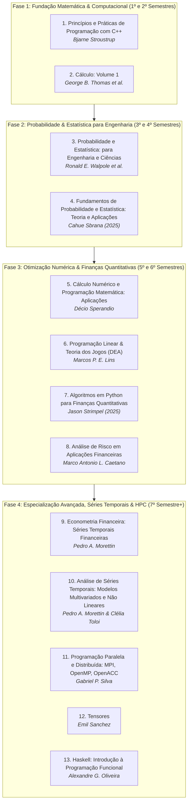

# 📚 Plano de Estudos e Leitura: Livros da UNIVESP
### Engenharia da Computação & Finanças Quantitativas / Alto Desempenho

Este plano organiza os **13 livros selecionados na Biblioteca Virtual da UNIVESP** em uma sequência lógica, progressiva e conectada diretamente com a grade curricular de Engenharia da Computação. O objetivo é construir primeiro uma base sólida em **Cálculo, Programação em C++ e Probabilidade/Estatística** para, em seguida, avançar em **métodos numéricos, finanças quantitativas, modelagem econométrica e computação de alta performance (HPC)**.

---

## 🗺️ Visão Geral da Trilha de Aprendizado (13 Livros)

---

## 🔹 Fase 1: Fundação Matemática e Computacional (1º e 2º Semestres)

> **Foco:** Dominar lógica de programação, memória, modularização e os conceitos essenciais de funções, limites, derivadas e integrais que sustentam toda a engenharia.

### 1. Princípios e Práticas de Programação com C++ (3ª Edição)
* **Autor:** Bjarne Stroustrup (Criador do C++)
* **Por que começar por ele:** É o livro fundamental de introdução à ciência da computação e engenharia. Ensina boas práticas de código, gerenciamento de memória (*Stack* vs *Heap*), ponteiros, vetores e modularização.
* **Disciplinas UNIVESP:** *Pensamento Computacional (COM100)*, *Algoritmos e Programação de Computadores*.

### 2. Cálculo: Volume 1
* **Autores:** George B. Thomas, Maurice D. Weir, Joel Hass
* **Por que estudar agora:** O "Cálculo de Thomas" é a referência internacional máxima para entender funções, taxas de variação (derivadas), limites e integrais. Cria a base analítica rigorosa para Cálculo Numérico e Física.
* **Disciplinas UNIVESP:** *Matemática Básica (MMB002)*, *Cálculo I*.

---

## 🔹 Fase 2: Probabilidade e Estatística para Engenharia (3º e 4º Semestres)

> **Foco:** Raciocínio sob incerteza, distribuições amostrais, variáveis aleatórias, testes de hipóteses e regressão linear.

### 3. Probabilidade e Estatística: para Engenharia e Ciências
* **Autores:** Ronald E. Walpole, Raymond H. Myers, Sharon L. Myers, Keying Ye
* **Objetivo:** O clássico de estatística aplicada com rigor matemático e problemas práticos de engenharia, confiabilidade e inferência.
* **Disciplinas UNIVESP:** *Probabilidade e Estatística*.

### 4. Fundamentos de Probabilidade e Estatística: Teoria, Métodos e Aplicações (1ª Ed., 2025)
* **Autor:** Cahue Sbrana
* **Objetivo:** Visão moderna e contemporânea da análise exploratória de dados, métodos estatísticos e aplicações práticas.

---

## 🔹 Fase 3: Otimização Numérica & Finanças Quantitativas (5º e 6º Semestres)

> **Foco:** Resolver modelos matemáticos por algoritmos computacionais e aplicá-los na análise de ativos, otimização de portfólios e gestão de risco.

### 5. Cálculo Numérico e Programação Matemática: Aplicações
* **Autor:** Décio Sperandio
* **Objetivo:** Algoritmos numéricos para raízes de equações, interpolação, integração numérica e sistemas lineares.
* **Disciplinas UNIVESP:** *Cálculo Numérico*, *Álgebra Linear*.

### 6. Programação Linear: com Aplicações em Teoria dos Jogos e Avaliação de Desempenho (DEA)
* **Autores:** Marcos Pereira Estellita Lins e Angela Cristina M. Silva
* **Objetivo:** Otimização linear com restrições (Método Simplex), teoria dos jogos e análise envoltória de dados (*Data Envelopment Analysis*).
* **Disciplinas UNIVESP:** *Pesquisa Operacional*, *Otimização*.

### 7. Algoritmos em Python para Finanças Quantitativas (1ª Ed., 2025)
* **Autor:** Jason Strimpel
* **Objetivo:** Criação de estratégias de trading algorítmico, precificação de derivativos, backtesting e simulações de Monte Carlo com NumPy, Pandas e SciPy.

### 8. Análise de Risco em Aplicações Financeiras (1ª Ed., 2017)
* **Autor:** Marco Antonio Leonel Caetano
* **Objetivo:** Métricas fundamentais de risco de mercado e crédito (*Value at Risk - VaR*, *Expected Shortfall*, testes de estresse).

---

## 🔹 Fase 4: Séries Temporais Avançadas, HPC e Concorrência (7º Semestre em Diante)

> **Foco:** Modelagem econométrica de nível de pós-graduação, computação paralela de alta performance (HPC), tensores e paradigmas funcionais seguros.

### 9. Econometria Financeira: um Curso em Séries Temporais Financeiras
* **Autor:** Pedro A. Morettin
* **Objetivo:** Modelagem de volatilidade condicional (modelos ARCH, GARCH), cointegração e análise estocástica do mercado financeiro.

### 10. Análise de Séries Temporais: Modelos Multivariados e Não Lineares (1ª Ed., 2020)
* **Autores:** Pedro A. Morettin e Clélia Maria Castro Toloi
* **Objetivo:** Modelos VAR (Vetores Autoregressivos), modelos com quebras estruturais e sistemas dinâmicos não lineares.

### 11. Programação Paralela e Distribuída: com MPI, OpenMP e OpenACC
* **Autores:** Gabriel P. Silva e Silvio E. Quincozes
* **Objetivo:** Computação de Alto Desempenho (*HPC*), computação distribuída com MPI, paralelismo de múltiplos núcleos com OpenMP e aceleração massiva via GPU com OpenACC.

### 12. Tensores
* **Autor:** Emil Sanchez
* **Objetivo:** Estruturas matemáticas multidimensionais, cálculo tensorial e suas aplicações em física e aprendizado profundo (*Deep Learning*).

### 13. Haskell: uma Introdução à Programação Funcional
* **Autor:** Alexandre Garcia de Oliveira
* **Objetivo:** Paradigma funcional puro, tipos estáticos avançados (Mônadas), imutabilidade e concorrência segura em sistemas críticos.

---

## 📊 Tabela de Resumo dos 13 Livros

| Ordem | Livro / Assunto | Autor(es) | Fase | Pré-requisito Principal |
| :---: | :--- | :--- | :---: | :--- |
| **01** | **Princípios e Práticas com C++** | Bjarne Stroustrup | 1 | Lógica básica |
| **02** | **Cálculo: Volume 1** | George B. Thomas et al. | 1 | Matemática Básica / Pré-Cálculo |
| **03** | **Probabilidade e Estatística: Engenharias** | Ronald E. Walpole et al. | 2 | Cálculo Básico e Álgebra |
| **04** | **Fundamentos de Probabilidade e Estatística** | Cahue Sbrana | 2 | Cálculo Básico |
| **05** | **Cálculo Numérico e Programação Matemática** | Décio Sperandio | 3 | Cálculo I e C++ |
| **06** | **Programação Linear e Teoria dos Jogos** | Marcos P. E. Lins | 3 | Álgebra Linear |
| **07** | **Algoritmos em Python para Finanças** | Jason Strimpel | 3 | Estatística e Programação Básica |
| **08** | **Análise de Risco em Aplicações Financeiras** | Marco Antonio L. Caetano | 3 | Probabilidade e Finanças |
| **09** | **Econometria Financeira** | Pedro A. Morettin | 4 | Estatística e Cálculo |
| **10** | **Séries Temporais: Multivariados e Não Lineares** | Pedro A. Morettin & Clélia Toloi | 4 | Séries Univariadas e Álgebra Linear |
| **11** | **Programação Paralela e Distribuída (MPI/OpenMP)** | Gabriel P. Silva | 4 | C++ Intermediário e SO |
| **12** | **Tensores** | Emil Sanchez | 4 | Álgebra Linear Avançada |
| **13** | **Haskell: Programação Funcional** | Alexandre G. Oliveira | 4 | Lógica Matemática |
